# HMS Hospital-App : Dossier de conception

Version du 25 novembre 2026

## 1. Résumé exécutif

HMS Hospital-App est un système d'information hospitalier (SIH) web, modulaire et entièrement paramétrable, conçu pour être déployé dans un hôpital réel sans modifier le code : tout ce qui est métier (structure, tarifs, workflows, référentiels, modèles de documents) vit en base et se configure depuis un module d'administration.

1. **Périmètre** : 29 services métier, de l'admission à la facturation, plus le portail patient et la téléconsultation (V2).
2. **Style d'architecture** : monolithe modulaire NestJS (TypeScript), un dossier par service, avec séparation stricte Controller → Service → Repository → Model. Les microservices ne sont pas retenus en V1 (voir §2).
3. **Couplage** : les modules ne s'importent jamais entre eux ; ils communiquent par un EventBus (EventEmitter en mémoire, BullMQ pour le différé et le fiable). Chaque module peut être extrait en service plus tard.
4. **Données** : PostgreSQL + Prisma, clés UUID, soft delete, données médicales immuables et versionnées, colonnes sensibles chiffrées.
5. **Paramétrage** : chaque paramètre a un code, un type, une valeur par défaut, une validation, des permissions, un versioning et un journal. Les changements s'appliquent à chaud (cache Redis invalidé par événement).
6. **Sécurité** : JWT + refresh tokens, RBAC + ABAC, MFA obligatoire pour les rôles sensibles, audit exhaustif des accès au dossier médical, séparation des tâches (prescrire ≠ valider ≠ dispenser ≠ encaisser).
7. **Interopérabilité** : modèle FHIR R4-ready, DICOM pour l'imagerie, API publique OpenAPI versionnée, webhooks signés.
8. **Exploitation** : Docker en local, Kubernetes en production, pipeline CI/CD à 10 étapes avec approbation manuelle avant la prod, RTO < 4 h, RPO < 1 h.
9. **Montée en charge** : de 10 à 1 000 utilisateurs simultanés par scalabilité horizontale de l'API sans état, PgBouncer, réplicas de lecture, Redis et files BullMQ.
10. **Livraison** : MVP = fondations (auth, paramétrage, audit, notifications) + patients, admission, consultation, facturation, puis V1 clinique complète, puis V2 (téléconsultation, BI avancée, HL7/FHIR actif).

**Hypothèses retenues** (à confirmer) : pays et réglementation non précisés, donc RGPD comme socle avec une couche « loi locale » paramétrable ; hébergement cloud européen ; TypeScript plutôt que JavaScript pur, pour la sûreté de typage d'un SI de santé (l'arborescence demandée est conservée, avec l'extension `.ts`).

## 2. Architecture globale (C4) et choix techniques

L'architecture retenue est un **monolithe modulaire** déployé en conteneurs : un seul déploiement backend, mais des modules étanches qui ne se parlent que par événements. C'est le meilleur compromis pour un SIH : transactions ACID entre admission, lit et facture (impossibles proprement entre microservices), une équipe réduite, et une porte de sortie vers les microservices module par module.

### 2.1 Niveau 1 : contexte système

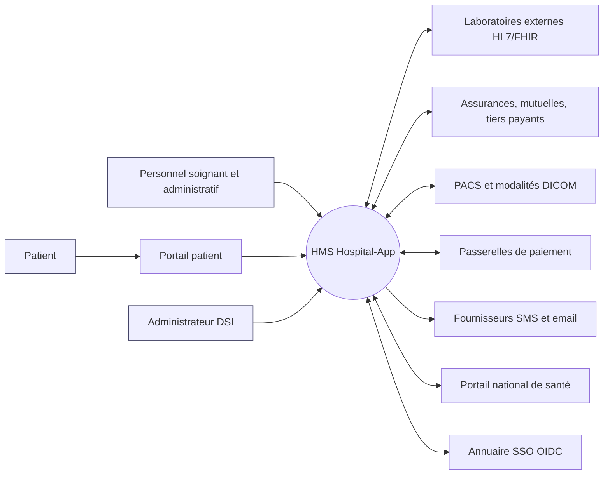

### 2.2 Niveau 2 : conteneurs

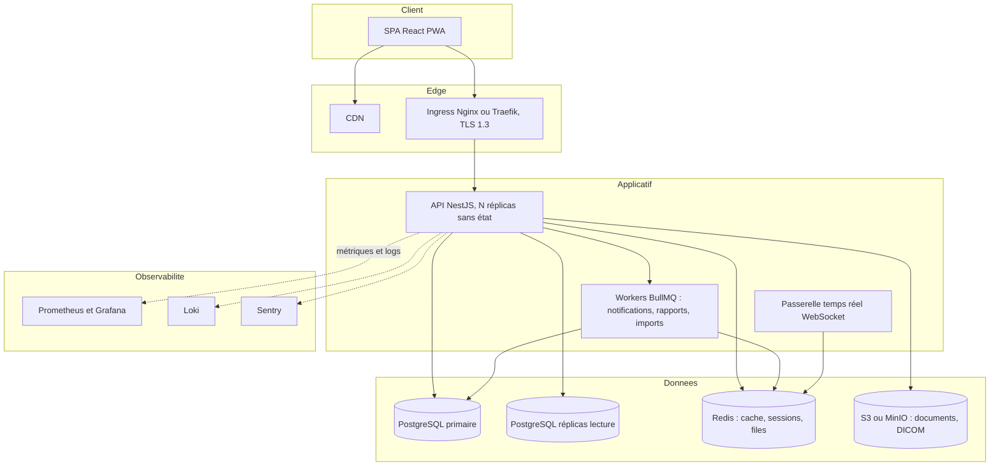

### 2.3 Niveau 3 : composants du backend

Chaque module métier suit la chaîne `Route → Middleware → Controller → Service → Repository → Model → BDD`, avec un EventBus latéral (détaillé en §6). Le noyau transverse (`core/`) fournit authentification, RBAC, audit, validation, cache, logger et erreurs ; `shared/` porte les modèles communs (Rôle, Permission, AuditLog, Notification, Document).

### 2.4 Choix techniques justifiés

| Choix | Raison | Alternative écartée |
| --- | --- | --- |
| NestJS (TypeScript) | Modules, injection de dépendances et guards natifs, qui imposent le MVC enrichi ; Swagger généré | Express nu : plus de discipline manuelle à tenir sur 30 modules |
| Monolithe modulaire | Transactions ACID entre modules, exploitation simple, coût réduit | Microservices : complexité réseau et transactions distribuées injustifiées en V1 |
| PostgreSQL + Prisma | Intégrité relationnelle, JSONB pour le paramétrage, row-level security possible, migrations versionnées | MongoDB : mauvais fit pour facturation et intégrité |
| Redis | Cache des paramètres et permissions, sessions, rate limiting, backend BullMQ | Cache en mémoire : incohérent avec plusieurs réplicas |
| BullMQ | Files fiables avec retry : SMS, PDF, imports, rapports | Cron seul : pas de reprise sur échec |
| S3 / MinIO | Documents et imagerie volumineux hors base, versioning d'objets | Fichiers en BDD : sauvegardes et coûts démesurés |
| React + TanStack Query + shadcn/ui | Pile imposée ; cache serveur, accessibilité Radix, design system cohérent |  |
| Kubernetes en prod | Mises à jour sans coupure, autoscaling, probes | Docker Compose seul : acceptable pour un petit hôpital (voir ci-dessous) |

### 2.5 Choix d'hébergement

| Option | Pour | Contre | Recommandation |
| --- | --- | --- | --- |
| Cloud managé européen (OVHcloud, Scaleway) | Souveraineté, coût maîtrisé, PostgreSQL et Kubernetes managés | Moins de services annexes qu'AWS | **Retenu par défaut** pour un hôpital européen ou africain francophone |
| AWS / GCP / Azure | Catalogue complet, régions multiples | Coût, hébergement de données de santé à qualifier selon le pays | Si la réglementation locale l'autorise |
| Sur site (on-premise) | Autonomie, faible latence, utile si connectivité limitée | Exploitation, PRA à la charge de l'hôpital | Mode dégradé : Docker Compose + sauvegardes externalisées |

Le frontend est servi par CDN (Cloudflare Pages ou équivalent). Pour un hôpital de district avec peu d'utilisateurs, un seul nœud Docker Compose avec sauvegardes chiffrées hors site suffit en phase pilote ; la même image passe ensuite sur Kubernetes sans réécriture.

### 2.6 Scalabilité de 10 à 1 000 utilisateurs simultanés

| Palier | Dimensionnement indicatif |
| --- | --- |
| 10 à 50 | 1 à 2 réplicas API, 1 PostgreSQL, 1 Redis |
| 50 à 300 | 3 réplicas API, PgBouncer, 1 réplica de lecture pour le reporting, workers dédiés |
| 300 à 1 000 | Autoscaling horizontal de l'API (HPA), réplicas de lecture, Redis en haute disponibilité, partitionnement des tables volumineuses (audit, mouvements de stock, résultats) par date |

Ces chiffres sont des points de départ à valider par les tests de charge k6 (§13), pas des garanties.

## 3. Découpage modulaire : 29 services métier

Chaque service est un module autonome `src/modules/<nom>/` contenant `controllers/ services/ repositories/ models/ routes/ dtos/ validators/ tests/`, avec les mêmes quatre règles : aucun import entre modules, échanges par événements, transactions dans le service, audit sur chaque route. Les 10 points exigés par service sont couverts par trois tableaux : identité et données (3.1), règles et écrans et API (3.2), puis événements et KPI (3.3). Les workflows détaillés sont en §9.

### 3.1 Objectif, acteurs et entités

| # | Module (dossier) | Objectif métier | Acteurs | Entités principales |
| --- | --- | --- | --- | --- |
| 1 | Auth et utilisateurs (`auth`) | Identifier, authentifier, autoriser | Tous, DSI | Utilisateur, Role, Permission, Session, FacteurMFA, RefreshToken |
| 2 | Paramétrage (`parametrage`) | Configurer l'hôpital sans redéploiement | DSI, Direction | Parametre, Referentiel, Workflow, ModeleDocument, Etablissement, Service, Unite, Lit |
| 3 | Patients (`patients`) | Dossier unique et MPI (identité maître) | Accueil, médecins | Patient, PieceIdentite, AyantDroit, Antecedent, Allergie, Consentement |
| 4 | Accueil et admission (`admission`) | Enregistrer, orienter, admettre | Accueil, infirmier | Admission, Orientation, Visite |
| 5 | Rendez-vous et consultations (`consultation`) | Planifier et réaliser les consultations externes | Médecin, accueil | RendezVous, Agenda, Consultation, Observation, Prescription |
| 6 | Urgences (`urgences`) | Triage, prise en charge, orientation | IOA, médecin urgentiste | PassageUrgence, Triage, CodeUrgence |
| 7 | Hospitalisation (`hospitalisation`) | Lits, chambres, mouvements | Infirmier, cadre, médecin | Hospitalisation, Lit, Mouvement, Transfert, Sortie |
| 8 | Bloc opératoire (`bloc`) | Planning et compte-rendu opératoire | Chirurgien, anesthésiste, IBODE | Intervention, SalleOperatoire, CompteRenduOperatoire, ChecklistBloc |
| 9 | Maternité (`maternite`) | Grossesse, accouchement, nourrisson | Obstétricien, sage-femme, pédiatre | Grossesse, SuiviPrenatal, Accouchement, Nouveau-né |
| 10 | Laboratoire (`laboratoire`) | Prescription → résultat validé | Biologiste, technicien | DemandeAnalyse, Prelevement, Analyse, Resultat, Automate |
| 11 | Imagerie (`imagerie`) | Examens, interprétation, compte-rendu | Radiologue, manipulateur | DemandeImagerie, Examen, Etude DICOM, CompteRenduImagerie |
| 12 | Pharmacie (`pharmacie`) | Stock, validation, dispensation | Pharmacien, préparateur | Medicament, Lot, Dispensation, Ordonnance, Officine |
| 13 | Stérilisation (`sterilisation`) | Tracer le cycle des dispositifs | Agent de stérilisation | Instrument, Boite, CycleSterilisation |
| 14 | Banque du sang (`banque-sang`) | Stocks de produits sanguins, transfusion | Biologiste, infirmier | PocheSang, Don, Compatibilite, Transfusion |
| 15 | Réanimation (`reanimation`) | Surveillance et soins intensifs | Réanimateur, IDE | SejourReanimation, ConstantesVitales, Scores |
| 16 | Soins infirmiers (`soins-infirmiers`) | Plan de soins et administrations | IDE, aide-soignant | PlanSoins, Soin, Administration, ObservationInfirmiere |
| 17 | Facturation et caisse (`facturation`) | Facturer, encaisser, tiers payant | Caissier, facturation | Facture, LigneFacture, Paiement, Assurance, PriseEnCharge, Remise |
| 18 | Ressources humaines (`personnel`) | Plannings, gardes, congés, paie, contrats | RH, cadres | Personnel, Contrat, Planning, Garde, Conge, BulletinPaie |
| 19 | Stocks et approvisionnements (`stock`) | Magasin général, commandes | Magasinier | Article, MouvementStock, Commande, Fournisseur, Inventaire |
| 20 | Maintenance (`maintenance`) | Équipements biomédicaux et techniques | Agent de maintenance | Equipement, OrdreTravail, Intervention, Calibration |
| 21 | Restauration (`restauration`) | Régimes et repas des patients | Diététicien, cuisine | Regime, Repas, ContrainteAlimentaire |
| 22 | Hygiène (`hygiene`) | Assainissement, infections associées aux soins | Agent d'hygiène, EOH | PlanNettoyage, Controle, SignalementInfection |
| 23 | Archivage médical (`archivage`) | Conservation légale des dossiers | Archiviste | DossierArchive, Emplacement, DemandeConsultation |
| 24 | Notifications (`notifications`) | SMS, email, push, portail | Système | Notification, Canal, ModeleNotification, Livraison |
| 25 | Reporting et BI (`reporting`) | Tableaux de bord décisionnels | Direction, chefs de service | Indicateur, Tableau, RapportPlanifie, Export |
| 26 | Audit et traçabilité (`audit`) | Journal inaltérable des accès et actions | Auditeur, DSI | AuditLog, AccesDossier, AlerteConformite |
| 27 | Administration système (`administration`) | Supervision, sauvegardes, intégrations | DSI | Sauvegarde, CleAPI, Webhook, EtatService |
| 28 | Portail patient (`portail-patient`) | Accès dossier, RDV, résultats, paiement | Patient | CompteAcces, DemandeRDV, PaiementEnLigne |
| 29 | Téléconsultation, V2 (`teleconsultation`) | Consultation à distance | Médecin, patient | SessionVideo, SalleVirtuelle |

### 3.2 Règles paramétrables, écrans et endpoints

Tous les endpoints sont sous `/api/v1/<module>`, au pluriel, avec pagination, filtres et tri. Chaîne de middlewares identique pour tous (§6).

| Module | Règles métier paramétrables | Écrans principaux | Endpoints REST principaux |
| --- | --- | --- | --- |
| auth | Complexité et durée de vie du mot de passe, rôles soumis à MFA, durée des sessions, verrouillage | Connexion, MFA, gestion des utilisateurs, matrice des rôles | `POST /auth/login`, `/auth/refresh`, `/auth/mfa/verify`, `GET/POST /users`, `/roles`, `/permissions` |
| parametrage | Tout le catalogue de §5 | Console d'administration par domaine, historique des valeurs, import de référentiels | `GET/PUT /settings/{code}`, `/referentials`, `/workflows`, `/document-templates`, `/facilities`, `/beds` |
| patients | Format du numéro de dossier, champs obligatoires par catégorie, seuil de détection de doublons | Recherche, fiche patient, fusion de doublons, consentements | `GET/POST /patients`, `POST /patients/{id}/merge`, `/allergies`, `/antecedents` |
| admission | Motifs d'admission, circuits d'orientation, pièces exigées | Accueil rapide, file d'attente, admission | `POST /admissions`, `/admissions/{id}/orient`, `GET /queues` |
| consultation | Durée des créneaux par spécialité, délais d'annulation, surréservation | Agenda, consultation, prescription | `/appointments`, `/agendas`, `/consultations`, `/prescriptions` |
| urgences | Grille de triage (ex. 5 niveaux), délais cibles par niveau, codes d'alerte | Tableau de bord urgences, triage, box | `/emergency-visits`, `/triage`, `/emergency-codes` |
| hospitalisation | Types de lits, durée max de transfert, règles d'affectation | Plan des lits, mouvements, sortie | `/hospitalizations`, `/beds/availability`, `/transfers`, `/discharges` |
| bloc | Durées types par acte, checklist de sécurité, priorités | Planning de bloc, compte-rendu opératoire | `/surgeries`, `/operating-rooms`, `/surgery-reports` |
| maternite | Calendrier de suivi prénatal, alertes de terme | Suivi de grossesse, salle de naissance | `/pregnancies`, `/deliveries`, `/newborns` |
| laboratoire | Valeurs de référence par âge et sexe, seuils critiques, règles d'auto-validation | Paillasse, validation, résultats | `/lab-orders`, `/samples`, `/lab-results`, `/lab-results/{id}/validate` |
| imagerie | Protocoles d'examen, délais de compte-rendu | Liste de travail, visualiseur, compte-rendu | `/imaging-orders`, `/studies`, `/imaging-reports` |
| pharmacie | Seuils d'alerte, règles de substitution, interactions bloquantes ou non | Ordonnances à valider, dispensation, stock | `/prescriptions/{id}/validate`, `/dispensations`, `/drug-stock` |
| sterilisation | Durées et paramètres de cycle | Cycles, traçabilité des boîtes | `/sterilization-cycles`, `/instrument-sets` |
| banque-sang | Durée de conservation par produit, règles de compatibilité | Stock de poches, transfusion | `/blood-units`, `/crossmatches`, `/transfusions` |
| reanimation | Seuils d'alarme par constante, scores actifs | Moniteur de chevet, scores | `/icu-stays`, `/vitals`, `/scores` |
| soins-infirmiers | Plans de soins types, fréquences, double contrôle de certains médicaments | Plan de soins, tournée, administration | `/care-plans`, `/care-tasks`, `/administrations` |
| facturation | Tarifs, conventions, taux de prise en charge, TVA, devises, plafonds de remise | Caisse, facture, tiers payant, rapprochement | `/invoices`, `/payments`, `/insurance-claims`, `/cash-sessions` |
| personnel | Types de contrat, règles de garde, soldes de congés, barèmes | Planning, gardes, congés, paie | `/staff`, `/schedules`, `/on-call`, `/leaves`, `/payslips` |
| stock | Seuils min et max, délais fournisseurs, méthode de valorisation | Articles, commandes, inventaire | `/items`, `/stock-movements`, `/purchase-orders`, `/inventories` |
| maintenance | Périodicité de maintenance et calibration | Parc d'équipements, ordres de travail | `/equipment`, `/work-orders`, `/calibrations` |
| restauration | Régimes, horaires de repas, exclusions allergiques | Commandes de repas, étiquettes | `/diets`, `/meal-orders` |
| hygiene | Plans de nettoyage par zone, fréquences | Tâches, contrôles, signalements | `/cleaning-plans`, `/hygiene-checks`, `/infection-reports` |
| archivage | Durées de conservation par type de document | Localisation, demandes de prêt | `/archives`, `/archive-requests` |
| notifications | Modèles multilingues, canaux, règles de relance | Modèles, historique d'envoi | `/notifications`, `/notification-templates`, `/channels` |
| reporting | Définition des indicateurs, périodicité des rapports | Tableaux de bord, exports | `/dashboards`, `/indicators`, `/reports` |
| audit | Durée de rétention, événements à alerter | Recherche d'audit, alertes | `GET /audit-logs`, `/access-logs`, `/compliance-alerts` |
| administration | Politique de sauvegarde, clés API, webhooks | Santé des services, sauvegardes | `/health`, `/backups`, `/api-keys`, `/webhooks` |
| portail-patient | Services ouverts, délais de publication des résultats | Accueil patient, RDV, résultats, paiement | `/portal/me`, `/portal/appointments`, `/portal/results`, `/portal/payments` |
| teleconsultation | Durée de session, fournisseur vidéo | Salle d'attente virtuelle, visio | `/teleconsultations`, `/teleconsultations/{id}/join` |

### 3.3 Événements inter-modules et KPI

Nommage des événements : `<domaine>.<objet>.<verbe passé>`. Chaque événement porte un `eventId`, un `occurredAt`, un `actorId` et l'identifiant de la ressource, jamais la donnée médicale elle-même.

| Module | Émet | Écoute | KPI et statistiques |
| --- | --- | --- | --- |
| auth | `user.logged_in`, `user.locked`, `mfa.failed` | `staff.contract_ended` | Taux d'activation MFA, échecs de connexion |
| parametrage | `setting.changed`, `referential.published` |  | Paramètres modifiés par période |
| patients | `patient.created`, `patient.merged` | `admission.created` | Doublons détectés, nouveaux patients |
| admission | `patient.admitted`, `patient.oriented` | `appointment.checked_in` | Temps d'attente à l'accueil |
| consultation | `appointment.booked`, `consultation.closed`, `prescription.created` | `patient.admitted`, `lab.result.ready` | Taux de non-présentation, consultations par médecin |
| urgences | `emergency.triaged`, `alert.critical` | `patient.admitted` | Délai porte-médecin, durée de séjour aux urgences |
| hospitalisation | `bed.assigned`, `patient.transferred`, `patient.discharged`, `patient.deceased` | `patient.admitted`, `surgery.completed` | Taux d'occupation, durée moyenne de séjour |
| bloc | `surgery.scheduled`, `surgery.completed` | `patient.admitted`, `lab.result.ready` | Taux d'utilisation des salles, retards |
| maternite | `delivery.completed`, `newborn.registered` | `patient.admitted` | Naissances, taux de césarienne |
| laboratoire | `lab.sample.collected`, `lab.result.ready`, `alert.critical` | `prescription.created`, `invoice.paid` | Délai de rendu, taux de résultats critiques |
| imagerie | `imaging.exam.done`, `imaging.report.ready` | `prescription.created` | Délai de compte-rendu, examens par modalité |
| pharmacie | `prescription.validated`, `pharmacie.dispensed`, `stock.low` | `prescription.created`, `invoice.paid` | Erreurs de dispensation, ruptures |
| sterilisation | `sterilization.cycle.completed` | `surgery.scheduled` | Conformité des cycles |
| banque-sang | `blood.unit.expiring`, `transfusion.completed` | `prescription.created` | Poches périmées, délai de mise à disposition |
| reanimation | `icu.alarm.raised` | `patient.admitted` | Durée de séjour, scores de gravité |
| soins-infirmiers | `care.administered`, `care.missed` | `prescription.validated`, `pharmacie.dispensed` | Soins réalisés à l'heure |
| facturation | `facture.created`, `facture.paid`, `claim.rejected` | `consultation.closed`, `patient.discharged`, `lab.result.ready` | Chiffre d'affaires, taux d'impayés, délai de recouvrement |
| personnel | `schedule.published`, `leave.approved` | `user.created` | Absentéisme, couverture des gardes |
| stock | `stock.low`, `purchase.order.created` | `pharmacie.dispensed`, `meal.consumed` | Rotation, valeur du stock, ruptures |
| maintenance | `equipment.down`, `workorder.closed` | `stock.low` | Disponibilité du parc, MTTR |
| restauration | `meal.prepared` | `patient.admitted`, `patient.discharged`, `allergy.recorded` | Repas servis, écarts de régime |
| hygiene | `infection.reported` | `patient.discharged` (nettoyage de chambre) | Taux d'infections associées aux soins |
| archivage | `record.archived` | `patient.discharged` | Délai de récupération d'un dossier |
| notifications | `notification.sent`, `notification.failed` | tous les événements notifiables | Taux de remise |
| reporting | `report.generated` | tous (lecture) | Fraîcheur des données |
| audit | `audit.anomaly.detected` | tous (écriture seule) | Accès hors périmètre |
| administration | `backup.completed`, `backup.failed` | `alert.critical` | Disponibilité, taux de réussite des sauvegardes |
| portail-patient | `portal.appointment.requested` | `lab.result.ready`, `facture.created` | Comptes activés, paiements en ligne |
| teleconsultation | `teleconsultation.ended` | `appointment.booked` | Sessions réussies |

### 3.4 Dépendances entre modules et zones à risque

Les modules **auth**, **parametrage**, **audit** et **notifications** sont des fondations : tous les autres en dépendent, donc ils sortent en premier et leurs contrats (permissions, paramètres, événements) doivent être figés tôt. Les dépendances métier suivent le parcours patient : `patients → admission → consultation / urgences / hospitalisation → prescriptions → laboratoire, imagerie, pharmacie → facturation`.

| Zone à risque | Pourquoi | Parade |
| --- | --- | --- |
| Identité patient (doublons, fusion) | Une erreur mélange deux dossiers médicaux | MPI avec score de similarité, fusion réversible, validation humaine |
| Circuit du médicament | Erreur de dose ou d'allergène = risque vital | Contrôles bloquants paramétrables, double validation, traçabilité par lot |
| Facturation et tiers payant | Règles de convention très variables | Moteur de tarification paramétrable, jeu de tests par convention |
| Paramétrage trop libre | Un mauvais paramètre peut casser un circuit clinique | Versioning, environnement de prévisualisation, double approbation des paramètres critiques, retour arrière |
| Intégration DICOM et automates de laboratoire | Matériel hétérogène, protocoles propriétaires | Couche d'adaptateurs isolée, V1 limitée à quelques modèles cibles |
| Connectivité faible | Perte de saisie en zone mal couverte | PWA avec file de synchronisation et résolution de conflits définie par entité |
| Conformité légale locale | Les règles sur les données de santé varient par pays | Validation juridique avant mise en production (§15) |

## 4. Acteurs et contrôle d'accès (RBAC + ABAC)

Les droits se composent de trois couches : un **rôle** donne un ensemble de permissions, une **permission** a la forme `MODULE_ACTION` (ex. `PHARMACIE_DISPENSE`, `LABORATOIRE_VALIDATE`, `FACTURATION_REFUND`), et des **attributs** (ABAC) restreignent l'accès à un contexte : service de rattachement, relation de soin active avec le patient, garde en cours, site. Les rôles, permissions et attributions sont des données paramétrables, pas du code. La matrice est exportée par `GET /api/v1/roles/matrix?format=csv|xlsx|json` et fournie comme seed (`prisma/seed/rbac.csv`).

### 4.1 Les 23 rôles

| Rôle | Périmètre | Actions métier spécifiques | MFA | Contrainte légale clé |
| --- | --- | --- | --- | --- |
| Directeur / Direction générale | Lecture transverse, reporting complet | Approuver tarifs et paramètres critiques | Obligatoire | Pas d'accès nominatif au contenu clinique sans motif |
| Médecin chef de service | Son service : consultation, hospitalisation, planning | Valider les protocoles du service, arbitrer les plannings | Obligatoire | Secret médical, accès limité au service |
| Médecin (généraliste, spécialiste, interne, externe) | Patients pris en charge | Prescrire, signer compte-rendus et certificats ; l'interne et l'externe prescrivent sous co-signature | Obligatoire | Secret médical, relation de soin exigée |
| Chirurgien, anesthésiste, obstétricien, pédiatre | Idem médecin + bloc, maternité | Compte-rendu opératoire, consentement anesthésique, acte d'accouchement | Obligatoire | Idem ; signature électronique des actes |
| IDE, IADE, IBODE, sage-femme | Patients de l'unité | Administrer, prélever, saisir constantes ; double contrôle sur médicaments à risque | Obligatoire en accès distant, sinon badge au poste | Secret professionnel |
| Aide-soignant | Soins délégués de l'unité | Saisir soins d'hygiène et constantes de base | Selon politique | Pas de prescription ni validation |
| Pharmacien | Pharmacie, stérilisation, lecture des prescriptions | Valider l'ordonnance, dispenser, gérer stupéfiants | Obligatoire | Traçabilité des stupéfiants et des lots |
| Préparateur en pharmacie | Pharmacie, sous contrôle | Préparer, délivrer après validation pharmacien | Selon politique | Pas de validation clinique |
| Biologiste | Laboratoire, banque du sang | Valider résultats, libérer produits sanguins | Obligatoire | Responsabilité de validation |
| Technicien de laboratoire | Paillasse | Saisir résultats, gérer automates | Selon politique | Pas de validation finale |
| Radiologue | Imagerie | Interpréter, signer le compte-rendu | Obligatoire | Secret médical |
| Manipulateur radio | Imagerie | Réaliser l'examen, transmettre au PACS | Selon politique | Radioprotection (doses tracées) |
| Réceptionniste / agent d'accueil | Identité, admission, agenda | Créer patient, prendre RDV, admettre | Selon politique | Aucun accès au contenu médical |
| Caissier / agent de facturation | Factures, caisse, tiers payant | Facturer, encaisser, rembourser avec plafond | Obligatoire | Données financières, lecture minimale de l'identité |
| Magasinier / gestionnaire de stock | Magasin général | Recevoir, sortir, inventorier | Selon politique | Séparation commande, réception, paiement |
| Responsable RH | Personnel, plannings, paie | Valider congés et paie | Obligatoire | Données personnelles des agents |
| Agent de sécurité | Registre des visites, incidents | Contrôler les accès physiques | Non | Aucune donnée médicale |
| Archiviste médical | Archivage | Archiver, prêter, détruire selon durée légale | Obligatoire | Conservation et destruction tracées |
| Agent de maintenance biomédicale | Équipements | Ouvrir et clôturer des ordres de travail | Non | Aucune donnée patient |
| Agent d'hygiène | Plans de nettoyage | Cocher les tâches, signaler | Non | Aucune donnée patient |
| Patient (portail) | Son propre dossier uniquement | Consulter, prendre RDV, payer, exercer ses droits | OTP à la connexion, obligatoire pour les résultats | RGPD : accès, rectification, portabilité, oubli |
| Administrateur système / DSI | Technique, paramétrage, sauvegardes | Gérer comptes et intégrations | Obligatoire, plus clé matérielle recommandée | Aucun accès clinique par défaut ; accès exceptionnel tracé |
| Auditeur / contrôleur | Lecture seule des journaux et rapports | Exporter les pistes d'audit | Obligatoire | Lecture seule, non modifiable |

### 4.2 Matrice rôle × famille de modules

Les 29 modules sont regroupés en 12 familles pour la lisibilité ; la matrice détaillée permission par permission est générée depuis la base. **L** lecture · **E** création et modification · **V** validation ou acte engageant (signature, dispensation, encaissement) · **A** administration complète · **\*** périmètre administratif seulement · **P** son propre dossier · **–** aucun accès. Tout accès clinique est de plus limité par l'ABAC (service, relation de soin).

| Rôle | Admin (auth, param, admin, audit) | Patients et admission | Consultation, urgences, téléconsult. | Hospit., soins, réa, bloc, maternité | Labo, imagerie, sang | Pharmacie, stérilisation | Facturation | RH | Stock, maint., resto, hygiène | Archivage | Reporting | Portail |
| --- | --- | --- | --- | --- | --- | --- | --- | --- | --- | --- | --- | --- |
| Directeur | L | L | L | L | L | L | L | L | L | L | A | – |
| Chef de service | – | L | V | V | L | L | – | E | – | – | L | – |
| Médecin | – | L | V | V | E | L | – | – | – | – | – | – |
| Chirurgien, anesth., obstét., pédiatre | – | L | V | V | E | L | – | – | – | – | – | – |
| IDE, IADE, IBODE, sage-femme | – | E | E | V | E | L | – | – | – | – | – | – |
| Aide-soignant | – | L | – | E | – | – | – | – | L | – | – | – |
| Pharmacien | – | L | L | L | L | V | – | – | E | – | L | – |
| Préparateur en pharmacie | – | – | – | – | – | E | – | – | L | – | – | – |
| Biologiste | – | L | L | L | V | – | – | – | – | – | L | – |
| Technicien de laboratoire | – | L | – | – | E | – | – | – | L | – | – | – |
| Radiologue | – | L | L | L | V | – | – | – | – | – | L | – |
| Manipulateur radio | – | L | – | – | E | – | – | – | – | – | – | – |
| Réceptionniste | – | E | E\* | – | – | – | – | – | – | – | – | – |
| Caissier, facturation | – | L\* | – | – | – | – | V | – | – | – | L | – |
| Magasinier | – | – | – | – | – | – | – | – | E | – | – | – |
| Responsable RH | – | – | – | – | – | – | – | V | – | – | L | – |
| Agent de sécurité | – | L\* | – | – | – | – | – | – | – | – | – | – |
| Archiviste | – | L\* | – | – | – | – | – | – | – | V | – | – |
| Maintenance biomédicale | – | – | – | – | – | – | – | – | E | – | – | – |
| Agent d'hygiène | – | – | – | – | – | – | – | – | E | – | – | – |
| Patient | – | – | – | – | – | – | – | – | – | – | – | P |
| Administrateur système / DSI | A | – | – | – | – | – | – | – | – | – | L | – |
| Auditeur | L | – | – | – | – | – | L | – | – | – | L | – |

### 4.3 Séparation des tâches

Le service refuse qu'un même utilisateur réalise deux étapes incompatibles sur le même objet. Les règles sont des paramètres (`security.sod.rules`), vérifiées dans la couche service, pas seulement dans l'interface.

| Circuit | Étapes qui doivent être faites par des personnes différentes |
| --- | --- |
| Médicament | Prescription → validation pharmaceutique → dispensation → administration |
| Laboratoire | Saisie du résultat → validation biologique |
| Facturation | Création de la facture → encaissement → annulation ou remboursement |
| Achats | Commande → réception → paiement du fournisseur |
| Comptes | Création d'un utilisateur → attribution d'un rôle sensible (double approbation) |
| Paramétrage critique | Modification d'un tarif ou d'un protocole → approbation |

### 4.4 Accès d'urgence (« bris de glace »)

Un soignant sans relation de soin peut ouvrir un dossier en urgence vitale après saisie d'un motif obligatoire. L'accès est accordé pour une durée limitée, journalisé en priorité haute et remonté au responsable de service et à l'auditeur pour revue.

## 5. Paramétrage exhaustif

Le module `parametrage` est la source unique de toute valeur métier : le code ne contient aucun tarif, délai, libellé, seuil ou statut codé en dur. Un paramètre est lu par les services via `SettingsService.get(code, scope)`, jamais depuis une constante.

### 5.1 Anatomie d'un paramètre

| Attribut | Rôle |
| --- | --- |
| `code` | Identifiant stable, en notation pointée (`billing.refund.max_amount`) |
| `label` | Libellé multilingue (i18n) affiché dans la console |
| `type` | `string`, `int`, `decimal`, `bool`, `enum`, `list`, `map`, `json`, `date`, `duration`, `cron`, `url`, `secret` |
| `default_value` | Valeur appliquée tant qu'aucune surcharge n'existe |
| `validation` | Schéma Zod (bornes, regex, valeurs permises, dépendances entre paramètres) |
| `scope` | Portées permises : global, établissement, service, rôle |
| `edit_permission` | Permission requise pour modifier (`PARAMETRAGE_UPDATE_<DOMAINE>`) |
| `criticality` | `normal` ou `critique` (un paramètre critique exige une double approbation) |
| `version`, `status`, `effective_from` | Versioning, état (brouillon, publié, retiré) et date d'effet planifiée |
| `change_log` | Qui, quand, ancienne valeur, nouvelle valeur, motif, adresse IP |

### 5.2 Mécanique de fonctionnement

1. **Résolution par portée** : service, puis établissement, puis global, puis valeur par défaut. La plus spécifique gagne.
2. **Cycle de vie** : brouillon → relecture → approbation (si critique) → publication → effet à la date choisie. Retour à une version antérieure en un clic.
3. **Application à chaud** : la publication émet `setting.changed` ; les réplicas invalident leur cache Redis. Aucun redémarrage.
4. **Prévisualisation** : un paramètre ou un workflow modifié peut être testé sur un jeu de données fictif avant publication.
5. **Export et import** : jeu de paramètres sérialisé en JSON ou YAML pour promouvoir staging vers production, avec diff avant import.
6. **Secrets** : les paramètres de type `secret` sont stockés dans le coffre (Vault ou équivalent), jamais affichés ni journalisés en clair.
7. **Garde-fous** : les bornes légales (ex. durée minimale de conservation) sont des validations que l'on ne peut pas descendre en dessous.

### 5.3 Entités paramétrables

Ce sont des tables de données éditables dans la console, chacune versionnée et journalisée.

| Domaine | Entités | Attributs paramétrables |
| --- | --- | --- |
| Structure | Établissement, pavillon, étage, service, unité fonctionnelle, salle, chambre, lit | Code, libellé, rattachement, type, capacité, tarif journalier, horaires, équipements, statut |
| Acteurs | Type de professionnel, spécialité, poste, type de garde, type de congé, modèle de planning | Libellé, qualification requise, quotas, règles de repos |
| Patients | Catégorie (assuré, indigent, VIP, militaire…), type de pièce d'identité, lien d'ayant droit, groupe sanguin, allergène, antécédent type | Champs obligatoires, tarif applicable, documents exigés |
| Tarification | Acte, prestation, examen, forfait, remise, convention, assureur et tiers payant, taxe et exonération, devise et taux | Prix par catégorie de patient, taux de prise en charge, plafonds, période de validité |
| Référentiels | CIM-10/11, ATC, nomenclature d'actes, banque de médicaments, catalogue d'analyses, catalogue d'examens d'imagerie | Version, date d'effet, statut, correspondances entre versions |
| Protocoles | Protocole de soins, protocole de prescription, par service | Étapes, produits, posologies par défaut, conditions d'application |
| Documents | Ordonnance, compte-rendu, certificat, bulletin de sortie, lettre de liaison | Gabarit, variables, en-tête, langue, version, signature requise |
| Workflows | Admission, sortie, transfert, décès, validation de résultat, etc. | Statuts, transitions, rôles autorisés, conditions, actions automatiques, délais |
| Notifications | Modèles par canal et par langue, déclencheurs, relances | Texte, variables, horaires autorisés, nombre de relances |
| Intégrations | Clé d'API, webhook, endpoint FHIR, mapping de champs | URL, secret, événements abonnés, périmètre, quota |

### 5.4 Paramètres scalaires

Les défauts ci-dessous sont des valeurs de départ livrées dans les seeds, à valider par l'hôpital ; aucune n'est codée dans le programme.

| Code | Libellé | Type | Défaut | Validation | Modifiable par |
| --- | --- | --- | --- | --- | --- |
| `i18n.default_locale` | Langue par défaut | enum | `fr` | Dans `i18n.enabled_locales` | DSI |
| `i18n.enabled_locales` | Langues actives | list | `fr`, `en` | Codes BCP-47 | DSI |
| `l10n.timezone` | Fuseau horaire | string | à régler à l'installation | Identifiant IANA | DSI |
| `l10n.date_format` | Format de date | enum | `DD/MM/YYYY` | Liste fermée | DSI |
| `l10n.currency.base` | Devise de base | string | à régler à l'installation | ISO 4217 | Direction |
| `l10n.currency.accepted` | Devises acceptées en caisse | list | devise de base | ISO 4217, taux défini | Direction |
| `security.password.min_length` | Longueur minimale | int | 12 | 8 à 128 | DSI |
| `security.password.max_age_days` | Durée de vie du mot de passe | int | 90 | 0 à 365 | DSI |
| `security.password.history` | Mots de passe mémorisés | int | 5 | 0 à 24 | DSI |
| `security.mfa.required_roles` | Rôles soumis à MFA | list | rôles « Obligatoire » du §4.1 | Codes de rôle existants | DSI (critique) |
| `security.mfa.methods` | Méthodes MFA | list | `totp`, `sms` | Liste fermée | DSI |
| `security.session.idle_timeout_min` | Inactivité avant déconnexion | int | 15 | 1 à 120, par famille de rôles | DSI |
| `security.session.absolute_hours` | Durée maximale de session | int | 12 | 1 à 24 | DSI |
| `security.login.max_attempts` | Échecs avant verrouillage | int | 5 | 3 à 10 | DSI |
| `security.login.lockout_min` | Durée de verrouillage | int | 15 | 1 à 1440 | DSI |
| `security.sod.rules` | Règles de séparation des tâches | json | table du §4.3 | Schéma de règles | DSI + Direction (critique) |
| `security.breakglass.duration_min` | Durée de l'accès d'urgence | int | 60 | 5 à 240 | DSI |
| `audit.retention_years` | Rétention des journaux d'audit | int | à fixer avec le juridique | ≥ minimum légal local | Direction (critique) |
| `backup.schedule` | Planification des sauvegardes | cron | `0 2 * * *` | Cron valide | DSI |
| `backup.retention_days` | Rétention des sauvegardes | int | 35 | 7 à 3650 | DSI |
| `patient.mrn.format` | Format du numéro de dossier | pattern | `{SITE}-{YYYY}-{SEQ:6}` | Variables connues, unicité garantie | Direction |
| `patient.duplicate.threshold` | Seuil de similarité pour doublon | decimal | 0,85 | 0,5 à 1 | Admin patients |
| `patient.merge.requires_approval` | Fusion soumise à approbation | bool | `true` |  | Direction |
| `patient.required_fields.<catégorie>` | Champs obligatoires par catégorie | list | nom, naissance, sexe | Champs existants | Admin patients |
| `appointment.slot_minutes.<spécialité>` | Durée d'un créneau | int | 20 | 5 à 240 | Chef de service |
| `appointment.cancel_deadline_h` | Délai d'annulation | int | 24 | 0 à 168 | Chef de service |
| `appointment.reminder_offsets_h` | Rappels avant RDV | list | 48, 2 | Entiers positifs | Chef de service |
| `triage.target_delay_min.<niveau>` | Délai cible par niveau de triage | map | selon l'échelle choisie | Croissant avec le niveau | Chef des urgences |
| `bed.auto_assignment` | Affectation automatique des lits | bool | `false` |  | Cadre de santé |
| `bed.cleaning_after_discharge` | Nettoyage obligatoire après sortie | bool | `true` |  | Hygiène |
| `discharge.require_summary` | Bulletin de sortie obligatoire | bool | `true` |  | Direction médicale |
| `pharmacy.interaction.blocking_levels` | Niveaux d'interaction bloquants | list | contre-indication | Niveaux du référentiel | Pharmacien-chef (critique) |
| `pharmacy.substitution.allowed` | Substitution générique autorisée | bool | `true` |  | Pharmacien-chef |
| `pharmacy.expiry_alert_days` | Alerte avant péremption | int | 90 | 1 à 730 | Pharmacien-chef |
| `pharmacy.narcotics.double_check` | Double contrôle des stupéfiants | bool | `true` | Non désactivable si exigé par la loi locale | Pharmacien-chef (critique) |
| `lab.critical_values.<analyte>` | Seuils critiques | map | selon le référentiel | Bornes cohérentes | Biologiste-chef (critique) |
| `lab.autovalidation.enabled` | Auto-validation de résultats | bool | `false` |  | Biologiste-chef (critique) |
| `billing.invoice.number_format` | Numérotation des factures | pattern | `{YYYY}-{SEQ:8}` | Séquence sans trou | Finance |
| `billing.discount.max_pct.<rôle>` | Remise maximale par rôle | int | 0 | 0 à 100 | Direction (critique) |
| `billing.refund.max_amount.<rôle>` | Remboursement maximal par rôle | decimal | 0 | ≥ 0 | Direction (critique) |
| `billing.payment.methods` | Moyens de paiement | list | espèces, carte, virement, mobile | Liste fermée | Finance |
| `billing.invoice.due_days` | Délai de paiement | int | 30 | 0 à 365 | Finance |
| `billing.rounding` | Règle d'arrondi | enum | selon la devise | Liste fermée | Finance |
| `stock.valuation_method` | Valorisation du stock | enum | `CMUP` | `FIFO` ou `CMUP` | Finance |
| `stock.negative_allowed` | Stock négatif autorisé | bool | `false` |  | Magasinier-chef |
| `hr.rest.min_hours_between_shifts` | Repos minimal entre deux gardes | int | 11 | ≥ minimum légal local | RH (critique) |
| `hr.oncall.max_per_month` | Gardes maximum par mois | int | selon contrat | > 0 | RH |
| `notif.channels.enabled` | Canaux actifs | list | email, sms | Liste fermée | DSI |
| `notif.quiet_hours` | Plage sans envoi | range | 21:00 à 07:00 | Heures valides | DSI |
| `notif.retry.max` | Nombre de réessais | int | 3 | 0 à 10 | DSI |
| `portal.results.publish_delay_h` | Délai avant publication des résultats | int | 0 | 0 à 168 | Direction médicale |
| `portal.online_payment.enabled` | Paiement en ligne | bool | `false` | Passerelle configurée | Finance |
| `integration.webhook.signature` | Algorithme de signature | enum | `HMAC-SHA256` | Liste fermée | DSI |
| `integration.api.rate_limit_per_min` | Quota d'API par clé | int | 600 | 10 à 100 000 | DSI |
| `archive.retention_years.<type>` | Conservation par type de document | int | à fixer avec le juridique | ≥ minimum légal local | Archiviste + Direction (critique) |
| `reporting.refresh_minutes` | Fraîcheur des tableaux de bord | int | 15 | 1 à 1440 | DSI |

## 6. Architecture backend : MVC enrichi

Chaque requête traverse la même chaîne, dans tous les modules. Les rôles de chaque couche sont stricts : c'est ce qui rend 29 modules maintenables par plusieurs équipes.

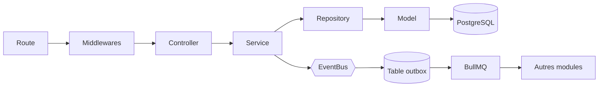

### 6.1 Arborescence du projet

L'arborescence demandée est reprise telle quelle, avec l'extension `.ts` (NestJS + TypeScript) et un fichier `*.module.ts` par module pour l'injection de dépendances.

```text
backend/
├── src/
│   ├── config/              # env validées (Zod), db, auth, constantes techniques
│   ├── core/                # noyau transverse
│   │   ├── database/        # client Prisma, transactions, seeders
│   │   ├── middlewares/     # authenticate, authorize, auditLog, validate, rateLimit, errors
│   │   ├── errors/          # erreurs métier typées
│   │   ├── events/          # EventBus, outbox, publishers, subscribers
│   │   ├── cache/           # Redis helpers, invalidation
│   │   ├── logger/          # pino structuré, masquage des données de santé
│   │   └── utils/
│   ├── modules/             # 1 dossier = 1 service métier
│   │   ├── auth/
│   │   │   ├── controllers/auth.controller.ts
│   │   │   ├── services/auth.service.ts
│   │   │   ├── repositories/auth.repository.ts
│   │   │   ├── models/user.model.ts
│   │   │   ├── routes/auth.routes.ts
│   │   │   ├── dtos/auth.dto.ts
│   │   │   ├── validators/auth.validator.ts
│   │   │   ├── tests/auth.test.ts
│   │   │   └── auth.module.ts
│   │   ├── patients/  admission/  consultation/  urgences/  hospitalisation/  bloc/
│   │   ├── maternite/  laboratoire/  imagerie/  pharmacie/  sterilisation/  banque-sang/
│   │   ├── reanimation/  soins-infirmiers/  facturation/  personnel/  stock/
│   │   ├── maintenance/  restauration/  hygiene/  archivage/  notifications/
│   │   ├── reporting/  audit/  administration/  portail-patient/  teleconsultation/
│   │   └── parametrage/
│   ├── shared/              # Role, Permission, AuditLog, Notification, Document
│   ├── routes/index.ts      # agrège les routes des modules sous /api/v1
│   ├── app.ts
│   └── server.ts
├── prisma/                  # schema.prisma, migrations/, seed/
├── tests/                   # unit, integration, e2e, charge (k6)
├── docker/
├── .env.example
└── package.json
```

### 6.2 Règle d'or par fichier

| Fichier | Contient | Ne contient jamais |
| --- | --- | --- |
| `*.routes.ts` | Endpoints, middlewares | Logique métier |
| `*.controller.ts` | Lecture de `req`, appel du service, `res` | Accès BDD, règles métier |
| `*.service.ts` | Toute la logique métier, transactions, émission d'événements | `req`/`res`, SQL |
| `*.repository.ts` | Accès BDD uniquement (Prisma) | Règles métier |
| `*.model.ts` | Schéma et types d'entité | Logique métier |
| `*.dto.ts` | Schémas Zod d'entrée et de sortie | Logique métier |
| `*.validator.ts` | Règles de validation détaillées | Accès BDD |

**Application automatique** : `dependency-cruiser` et une règle ESLint font échouer la CI si un module en importe un autre, si un controller importe un repository, ou si un service importe `express` ou `@nestjs/common` pour lire une requête.

### 6.3 Chaîne de middlewares

Ordre imposé : `authenticate → authorize(permission) → auditLog(action) → validate(dto) → rateLimit → controller`.

| Étape | Fonction | Sortie en cas d'échec |
| --- | --- | --- |
| `authenticate` | Vérifie le JWT, charge `req.user` ; rotation du refresh token | 401 |
| `authorize(perm)` | RBAC : permission requise ; ABAC : service et relation de soin ; règles de séparation des tâches | 403 |
| `auditLog(action)` | Écrit utilisateur, action, ressource, IP, horodatage, résultat (écrit aussi en cas d'échec) | Jamais bloquant pour la réponse, mais l'échec d'écriture est une alerte critique |
| `validate(dto)` | Valide avec Zod, injecte `req.validated` | 400 |
| `rateLimit` | Quota par utilisateur et par route sensible (Redis) | 429 |
| `errorHandler` | Convertit les erreurs métier en JSON propre, sans fuite d'information | 4xx / 5xx |

Un limiteur global par adresse IP est placé en amont, à l'ingress, pour absorber les abus avant même l'authentification ; le `rateLimit` de la chaîne ci-dessus est le limiteur fin, par utilisateur et par route.

### 6.4 Exemple : dispensation d'un médicament

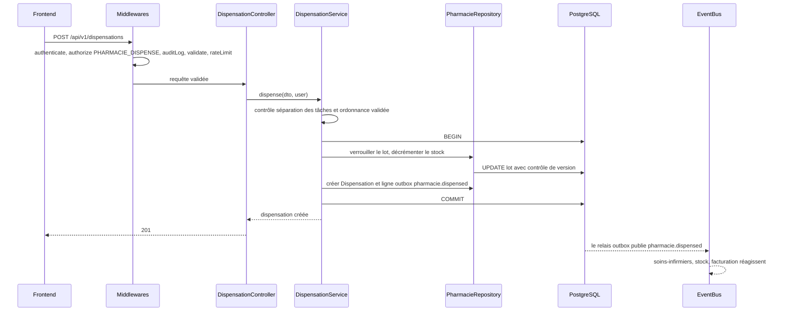

### 6.5 Transactions et événements

- **Transactions obligatoires** pour les flux critiques : admission, mouvement de lit, dispensation, paiement, validation de résultat, écriture de facture. Elles sont ouvertes dans le service, jamais dans le controller ni le repository ; le repository reçoit le contexte transactionnel en paramètre.
- **Pattern outbox** : l'événement est écrit dans une table `outbox` dans la même transaction que la donnée. Un relais le publie ensuite. Cela garantit qu'aucun événement n'est perdu ni émis pour une transaction annulée, ce qu'un simple `emit()` après commit ne garantit pas.
- **Deux vitesses** : événements de domaine en mémoire pour les réactions immédiates et peu critiques ; événements d'intégration via outbox puis BullMQ (retry, dead-letter) pour les effets à garantir (facturation, notifications, stock).
- **Idempotence** : les consommateurs dédupliquent par `eventId` ; les routes de paiement et de dispensation exigent un en-tête `Idempotency-Key`.
- **Concurrence** : verrou optimiste (colonne `version`) sur dossiers, lits et lots ; verrou pessimiste (`SELECT ... FOR UPDATE`) limité aux décréments de stock et à l'affectation de lit.

### 6.6 Conventions transverses

| Sujet | Règle |
| --- | --- |
| Versionnement d'API | Préfixe `/api/v1` ; une rupture crée `/api/v2` en parallèle |
| Pagination | Par curseur sur les listes volumineuses, par page pour les petites |
| Erreurs | Format unique `{ code, message, details, correlationId }` ; codes métier stables |
| Journalisation | `pino` JSON, identifiant de corrélation propagé de l'ingress aux workers, **masquage** des champs de santé et d'identité |
| Documentation | OpenAPI généré depuis les DTO Zod, publié par module |
| Dates | Stockage en UTC, affichage selon `l10n.timezone` |
| Fichiers | URL pré-signées S3 de courte durée ; jamais de binaire dans la base |

## 7. Architecture frontend (React)

Le frontend est organisé par fonctionnalité, un dossier par module backend, ce qui permet à une équipe de posséder un module de bout en bout. L'équivalent MVC côté client : **Model** = `api/` + `hooks/`, **View** = `components/`, **Controller** = `pages/`.

```text
frontend/src/
├── features/                # 1 dossier = 1 module backend
│   ├── patients/
│   │   ├── api/             # appels HTTP typés (Model)
│   │   ├── hooks/           # TanStack Query : usePatient, useCreatePatient (Model)
│   │   ├── components/      # UI pure, sans appel réseau (View)
│   │   ├── pages/           # orchestration : hooks + composants + routage (Controller)
│   │   ├── schemas/         # schémas Zod partagés avec le backend
│   │   └── types/
│   ├── pharmacie/  admission/  laboratoire/  facturation/  parametrage/  ...
├── components/ui/           # design system shadcn/ui
├── lib/                     # apiClient, auth, i18n, permissions, utils
├── stores/                  # Zustand : auth, préférences, thème, file hors-ligne
├── layouts/                 # un layout par famille de rôles
└── App.tsx
```

### 7.1 Rôle de chaque brique

| Brique | Usage dans le projet |
| --- | --- |
| React Router 6+ | Routes chargées à la demande par module ; **guards** par authentification, rôle et permission |
| TanStack Query | Cache serveur, invalidation sur mutation, mises à jour optimistes uniquement pour les actions sans risque clinique |
| React Hook Form + Zod | Formulaires ; les schémas Zod sont importés du package partagé `@hms/schemas`, donc une seule vérité front et back |
| Zustand | État global minimal : session, préférences, thème, file de synchronisation hors-ligne |
| i18next | Français, anglais et langues locales ; libellés métier chargés depuis le paramétrage, pas depuis des fichiers figés |
| Tailwind + shadcn/ui (Radix) | Composants accessibles, thème clair et sombre par variables CSS |
| Vite + code splitting | Un chunk par module ; seul le module ouvert est téléchargé |

### 7.2 Guards et interface pilotée par les permissions

- Le jeton de session porte la liste des permissions ; un composant `<Can permission="PHARMACIE_DISPENSE">` masque ce que l'utilisateur ne peut pas faire. **Le masquage est un confort : le contrôle réel reste côté serveur.**
- Le menu est généré depuis les permissions et le paramétrage des modules actifs, donc un module désactivé pour un hôpital disparaît de l'interface sans modification de code.
- Un layout par famille de rôles (soignant, accueil et caisse, pharmacie et laboratoire, administration, patient) adapte la navigation et la densité d'information.
- Les écrans de saisie clinique et les formulaires de **paramétrage** sont générés depuis des schémas (champs, validations, libellés) pour que la console couvre tous les paramètres du §5 sans développement par paramètre.

### 7.3 Hors-ligne partiel (PWA)

Le hors-ligne est limité aux cas où un conflit se résout sans risque clinique. Il repose sur un service worker, IndexedDB chiffré et une file de synchronisation.

| Fonction | Hors-ligne | Conflit |
| --- | --- | --- |
| Consultation du dossier déjà ouvert, du planning, des protocoles | Lecture seule en cache | Sans objet |
| Saisie de constantes, notes infirmières, observations | Saisie en file | Fusion par horodatage, jamais d'écrasement |
| Enregistrement d'un patient et d'une admission | Saisie en file avec identifiant provisoire | Contrôle de doublon à la synchronisation |
| Prescription, validation, dispensation, paiement | **Non autorisé** | Exige une connexion pour la sécurité |

Les données locales sont chiffrées avec une clé dérivée de la session et purgées à la déconnexion.

### 7.4 Accessibilité, erreurs et performance

- **Accessibilité WCAG 2.1 AA** : navigation clavier complète, contrastes vérifiés dans les deux thèmes, libellés ARIA, tests `axe-core` en CI.
- **Erreurs** : un gestionnaire central convertit les codes d'erreur de l'API en messages traduits ; toasts pour les erreurs récupérables, écran d'erreur dédié sinon, retry automatique limité aux requêtes de lecture.
- **Sessions** : déconnexion automatique sur inactivité avec avertissement avant expiration, et verrouillage d'écran conservant l'état de saisie.
- **Performance** : budget de bundle par module, listes virtualisées pour les grandes tables, images médicales chargées par tuiles ou par visualiseur dédié.

## 8. Modèle de données

Le schéma est unique (PostgreSQL), géré par Prisma, avec un préfixe de table par module pour que chaque module reste propriétaire de ses tables : un module ne lit jamais directement la table d'un autre, il passe par son API interne ou un événement. L'ERD ci-dessous montre le noyau transverse ; les entités propres à un module (stérilisation, maintenance, restauration…) se rattachent au patient, au personnel ou à l'établissement par les mêmes clés.

### 8.1 ERD du noyau

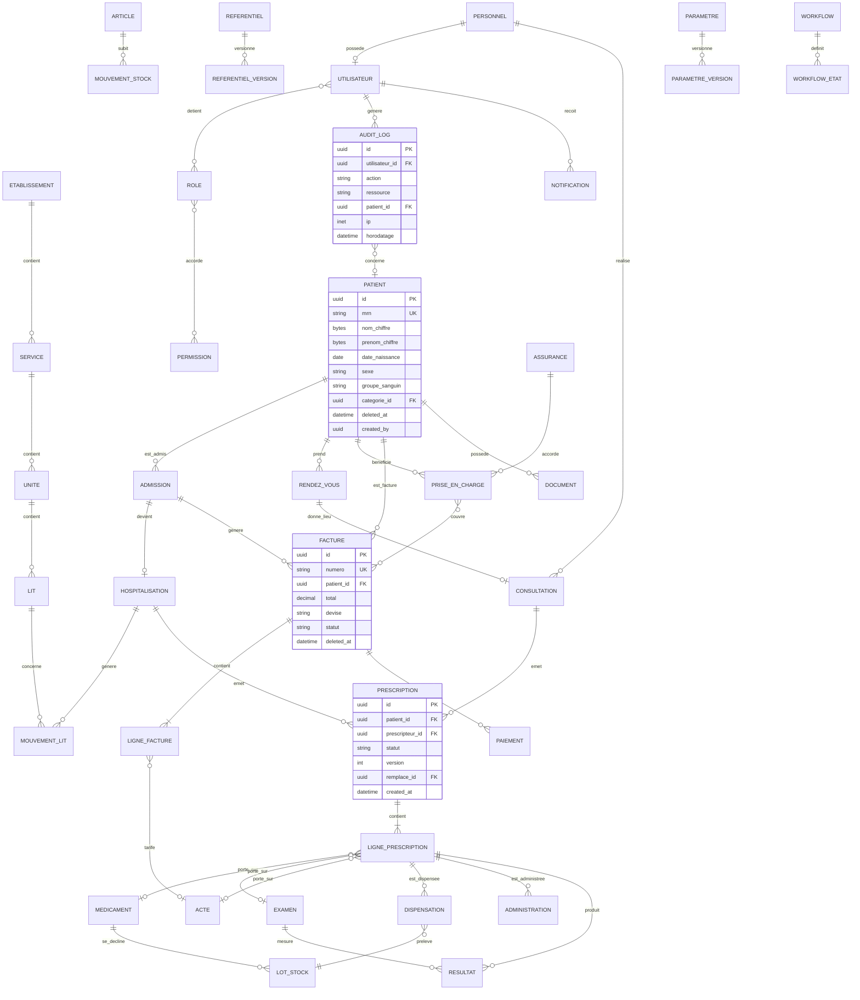

### 8.2 Entités clés : attributs, index et intégrité

Types abrégés : `uuid`, `text`, `int`, `dec` (décimal), `ts` (timestamptz), `jsonb`, `enc` (chiffré applicativement). `?` = nullable.

| Entité | Attributs principaux | Index et contraintes | Suppression | Versioning |
| --- | --- | --- | --- | --- |
| `patient` | id, mrn, nom `enc`, prenom `enc`, naissance, sexe, groupe\_sanguin?, categorie\_id, telephone `enc`?, adresse `enc`? | `UNIQUE(mrn)` ; index sur `blind_index(nom, naissance)` pour recherche et doublons | Soft delete interdit, archivage ; fusion réversible | Historique d'identité append-only |
| `piece_identite` | id, patient\_id, type\_id, numero `enc`, validite? | `UNIQUE(type_id, hash(numero))` | Soft | Non |
| `allergie` | id, patient\_id, allergene\_id, severite, statut | Index `(patient_id, statut)` | Jamais supprimée, marquée « erronée » | Append-only |
| `admission` | id, patient\_id, etablissement\_id, motif\_id, statut, admis\_le, sorti\_le? | Index `(patient_id, admis_le desc)` ; une seule admission ouverte par patient et établissement | Soft | Transitions à l'état journalisées |
| `rendez_vous` | id, patient\_id, agenda\_id, debut, fin, statut | Contrainte d'exclusion sur `(agenda_id, plage)` contre les chevauchements | Soft | Non |
| `consultation` | id, rdv\_id?, patient\_id, praticien\_id, motif, compte\_rendu `enc`, signee\_le? | Index `(patient_id, created_at desc)` | Interdit | **Immuable après signature** : correction = nouvelle version |
| `hospitalisation` | id, admission\_id, unite\_id, lit\_id, debut, fin? | Un lit ne porte qu'une hospitalisation active (index unique partiel) | Soft | Mouvements append-only |
| `lit` | id, unite\_id, code, type\_id, statut, version | `UNIQUE(unite_id, code)` ; verrou optimiste | Soft | Paramétrage versionné |
| `prescription` | id, patient\_id, prescripteur\_id, contexte, statut, version, remplace\_id? | Index `(patient_id, statut)` | Interdit | **Immuable après validation** ; modification = nouvelle ligne `remplace_id` |
| `ligne_prescription` | id, prescription\_id, type, produit\_id, posologie jsonb, duree | FK vers l'un des trois référentiels (CHECK un seul non nul) | Interdit | Avec la prescription |
| `dispensation` | id, ligne\_id, lot\_id, quantite, dispensateur\_id, horodatage | CHECK `quantite > 0` ; `UNIQUE(idempotency_key)` | Interdit | Append-only |
| `administration` | id, ligne\_id, infirmier\_id, dose, horodatage, statut | Index `(ligne_id, horodatage)` | Interdit | Append-only |
| `resultat` | id, ligne\_id, examen\_id, valeur, unite, valide\_par?, valide\_le? | Index `(examen_id, valide_le)` ; partitionné par date | Interdit | **Immuable après validation** ; rectification = nouvelle version |
| `lot_stock` | id, medicament\_id, numero\_lot, peremption, quantite, version | `UNIQUE(medicament_id, numero_lot)` ; CHECK `quantite >= 0` sauf paramétrage | Soft | Mouvements append-only |
| `mouvement_stock` | id, article\_id, sens, quantite, motif, reference | Partitionné par mois ; CHECK `quantite > 0` | Interdit | Append-only |
| `facture` | id, numero, patient\_id, admission\_id?, devise, total, statut | `UNIQUE(numero)` sans trou ; CHECK `total = somme des lignes` | Interdit après émission : avoir | Avoir et réémission |
| `paiement` | id, facture\_id, moyen, montant, devise, taux, caissier\_id | CHECK `montant > 0` ; `UNIQUE(idempotency_key)` | Interdit | Annulation = écriture inverse |
| `prise_en_charge` | id, patient\_id, assurance\_id, taux, plafond?, debut, fin? | Index `(patient_id, debut, fin)` ; plages sans chevauchement par assurance | Soft | Versionnée par période |
| `document` | id, patient\_id, type\_id, modele\_version, cle\_s3, hash\_sha256, signe\_par? | `UNIQUE(cle_s3)` ; hash vérifié à la lecture | Soft + rétention | Chaque version conservée dans S3 |
| `audit_log` | id, utilisateur\_id, action, ressource, ressource\_id, patient\_id?, ip, horodatage, resultat | Partitionné par mois ; index `(patient_id, horodatage)` | **Jamais** ; rôle BDD sans droit UPDATE/DELETE | Chaîne de hachage pour détecter la falsification |
| `parametre` et `parametre_version` | code, type, valeur jsonb, portée, version, statut, effet\_le | `UNIQUE(code, portée, version)` | Soft | Toute modification crée une version |
| `referentiel` et `referentiel_version` | code, version, effet\_le, statut, entrees | `UNIQUE(code, version)` | Soft | Versions publiées immuables |
| `workflow`, `workflow_etat`, `workflow_transition` | code, etats, transitions, rôles autorisés | `UNIQUE(workflow_id, code)` | Soft | Versionné |
| `notification` | id, canal, destinataire, modele\_id, statut, tentatives | Index `(statut, prochaine_tentative)` | Purge planifiée | Non |

### 8.3 Conventions transverses

| Sujet | Règle |
| --- | --- |
| Nommage | `snake_case`, tables au singulier préfixées par module (`pharmacie_lot_stock`) |
| Clés primaires | UUID (v4 conforme à la demande ; ULID ou UUID v7 recommandé si la localité d'index devient un problème d'écriture) |
| Traçabilité | Toutes les tables : `created_at`, `created_by`, `updated_at`, `updated_by`, `version` |
| Soft delete | `deleted_at` sur les données administratives ; **interdit** sur les données médicales, financières et d'audit (correction par nouvelle version ou écriture inverse) |
| Données médicales | Immuables une fois signées ; toute correction crée une version liée (`remplace_id`) avec motif et auteur, l'ancienne restant consultable |
| Chiffrement colonnes | Chiffrement applicatif AES-256-GCM avec clé de données par table, chiffrée par une clé maître du KMS (chiffrement d'enveloppe) ; recherche via **index aveugle** (HMAC) sur les champs chiffrés |
| Droit à l'effacement | Limité par l'obligation légale de conservation : le dossier est conservé, restreint, puis **anonymisé** à l'échéance de `archive.retention_years` |
| Partitionnement | `audit_log`, `mouvement_stock`, `resultat`, `notification` par date |
| Migrations | Prisma Migrate versionnées, revues, appliquées en CI/CD ; migrations rétro-compatibles (« expand puis contract ») pour déployer sans coupure |
| Seeds | `seed/reference` (rôles, permissions, paramètres par défaut, référentiels de base) idempotent en tous environnements ; `seed/demo` (patients fictifs, structure type) **uniquement** en dev et staging |

## 9. Workflows transverses

Les statuts, transitions, rôles autorisés et délais ci-dessous sont les **valeurs par défaut des seeds** ; chaque hôpital les adapte dans le module de paramétrage (§5.3, entité Workflow). Une transition non déclarée est refusée par le service, quelle que soit l'interface.

### 9.1 Parcours patient complet

**Acteurs** : réceptionniste, médecin, IDE, caissier. **Statuts d'admission** : planifiée, ouverte, en cours, sortie prononcée, clôturée administrativement, facturée, archivée. **Notifications** : rappel de RDV, confirmation d'admission, facture disponible.

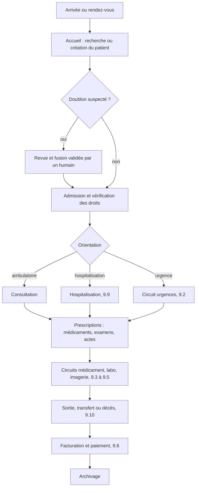

### 9.2 Parcours urgences

**Acteurs** : agent d'accueil, infirmier d'accueil et d'orientation (IOA), médecin urgentiste. **Règles** : le niveau de triage fixe le délai cible (`triage.target_delay_min.<niveau>`) ; un dépassement lève une alerte au chef de service ; un niveau vital déclenche directement le déchocage sans attendre l'enregistrement administratif complet (identité provisoire, régularisée ensuite).

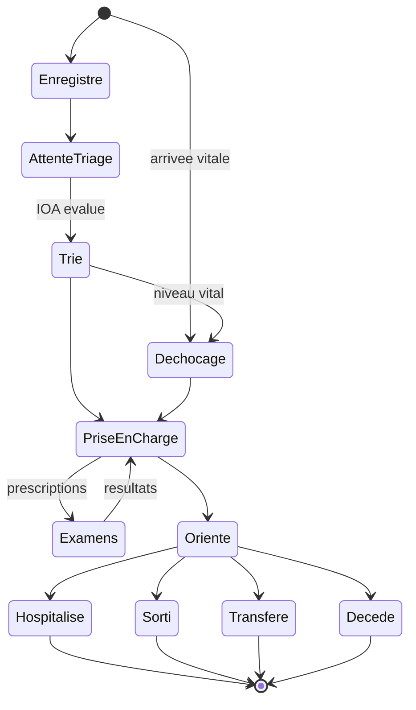

### 9.3 Circuit du médicament

**Acteurs** : prescripteur, pharmacien, préparateur, IDE. **Événements** : `prescription.created`, `prescription.validated`, `pharmacie.dispensed`, `care.administered`. **Règles** : quatre étapes, quatre personnes différentes (§4.3) ; contrôles automatiques d'allergie, d'interaction et de dose, bloquants ou avertissants selon `pharmacy.interaction.blocking_levels` ; administration à double contrôle pour les produits à risque.

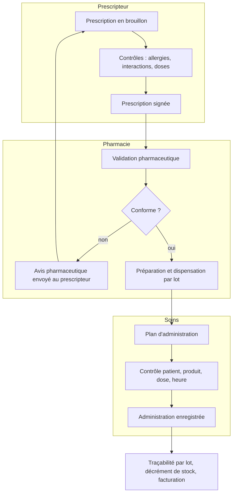

### 9.4 Circuit laboratoire

**Acteurs** : prescripteur, IDE, technicien, biologiste. **Statuts** : prescrit, prélevé, reçu, rejeté, en analyse, résultat saisi, validé, publié. **Règles** : le biologiste valide, le technicien saisit ; un résultat hors seuil critique (`lab.critical_values`) émet `alert.critical` vers le prescripteur avant même la validation finale.

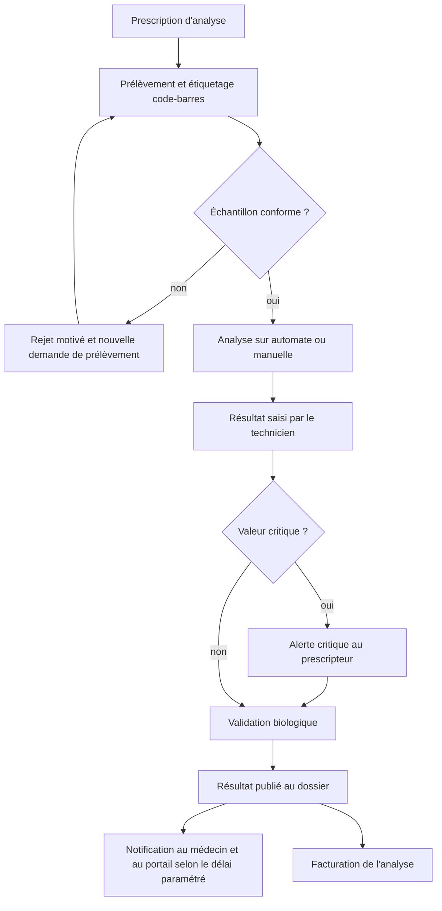

### 9.5 Circuit imagerie

**Acteurs** : prescripteur, accueil imagerie, manipulateur radio, radiologue. **Règles** : vérification des contre-indications (grossesse, allergie aux produits de contraste) avant l'examen ; images stockées au PACS selon DICOM ; le compte-rendu n'est diffusé qu'après signature du radiologue ; délai cible de compte-rendu paramétrable, avec alerte de dépassement.

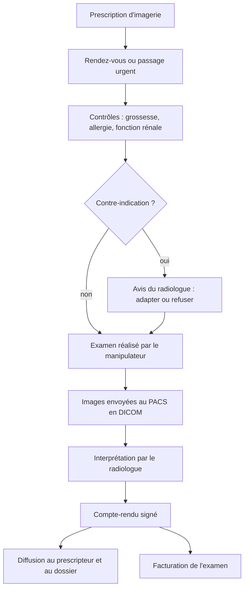

### 9.6 Facturation, tiers payant et assurance

**Acteurs** : caissier, agent de facturation, assureur. **Statuts de facture** : brouillon, émise, partiellement payée, payée, en litige, annulée par avoir. **Règles** : la facture est calculée depuis les actes réellement réalisés (événements des autres modules) et les tarifs en vigueur à la date de l'acte ; une facture émise est immuable, toute correction passe par un avoir ; le remboursement est plafonné par rôle.

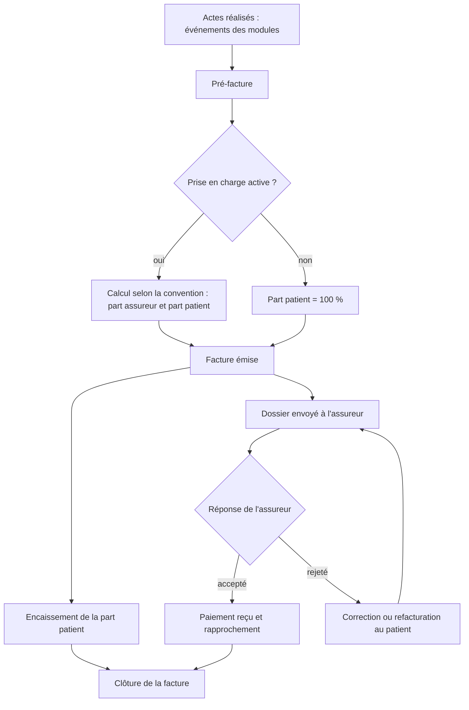

### 9.7 Stocks et réapprovisionnement

**Acteurs** : magasinier, responsable de stock, finance, fournisseur. **Événements** : `stock.low`, `purchase.order.created`. **Règles** : seuil minimal et couverture cible paramétrables par article ; la proposition de commande est calculée, jamais envoyée sans validation ; celui qui commande ne réceptionne pas et ne paie pas (§4.3) ; les lots proches de la péremption remontent en alerte (`pharmacy.expiry_alert_days`).

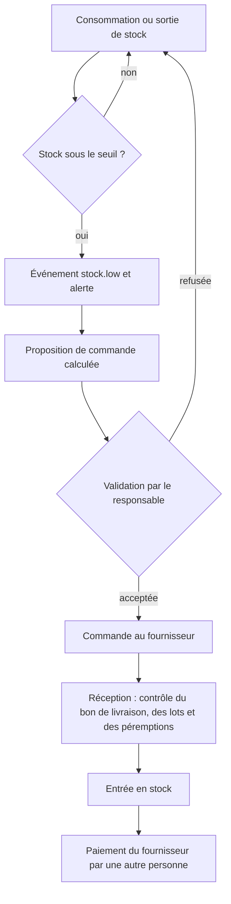

### 9.8 Gardes et plannings

**Acteurs** : cadre de santé, chef de service, responsable RH, personnel. **Règles** : le planning est généré à partir d'un modèle et vérifie les contraintes (repos minimal `hr.rest.min_hours_between_shifts`, quotas de gardes, qualifications requises par poste, congés approuvés) ; un échange de garde exige l'accord des deux agents puis la validation du cadre ; toute publication notifie les agents concernés.

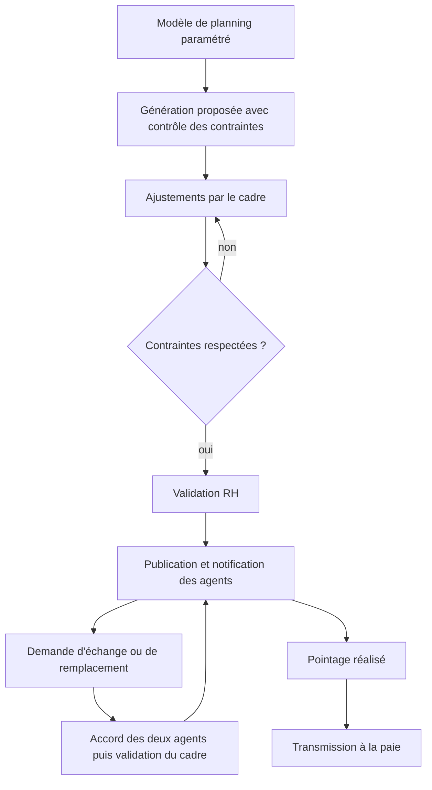

### 9.9 Admission en hospitalisation et mouvements de lits

**Acteurs** : médecin, cadre de santé ou gestionnaire de lits, IDE, agent d'hygiène. **Règles** : l'affectation tient compte du type de lit, du sexe, de l'isolement et des contraintes du service ; la réservation d'un lit pose un verrou pour qu'un lit ne soit jamais attribué deux fois ; après une sortie, le lit passe à « à nettoyer » tant que l'hygiène n'a pas validé (`bed.cleaning_after_discharge`).

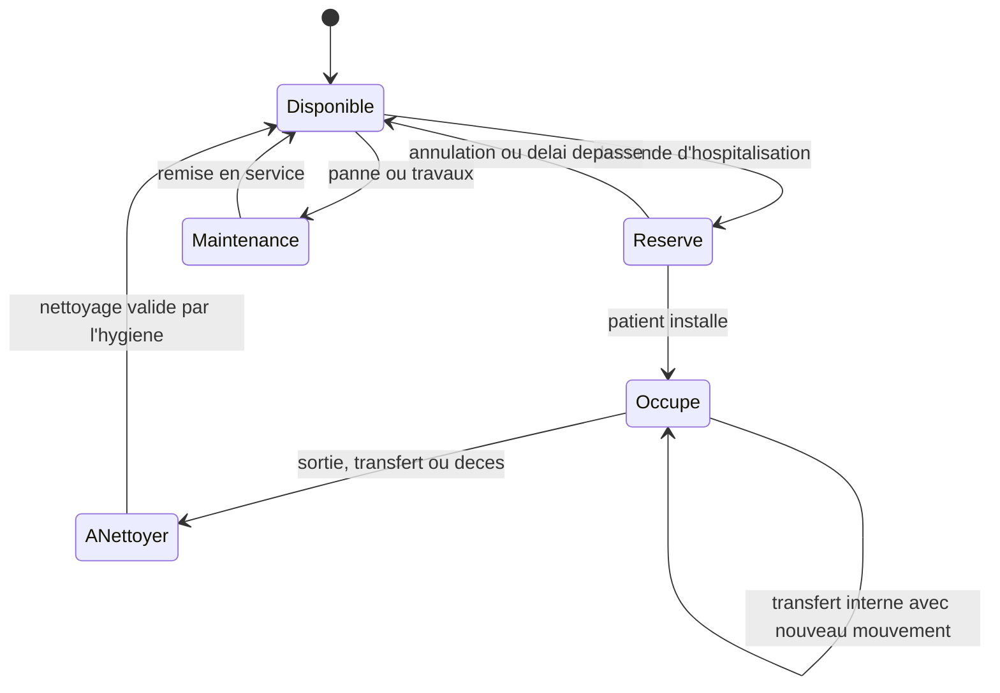

### 9.10 Sortie, transfert et décès

**Acteurs** : médecin, IDE, accueil, caissier, archiviste, établissement receveur. **Règles** : une sortie exige le bulletin de sortie (`discharge.require_summary`) ; un transfert exige l'accord de l'établissement receveur et la transmission du dossier ; un décès est constaté et certifié par un médecin, bloque les prescriptions et rendez-vous en cours, et déclenche les démarches de l'état civil selon la réglementation locale.

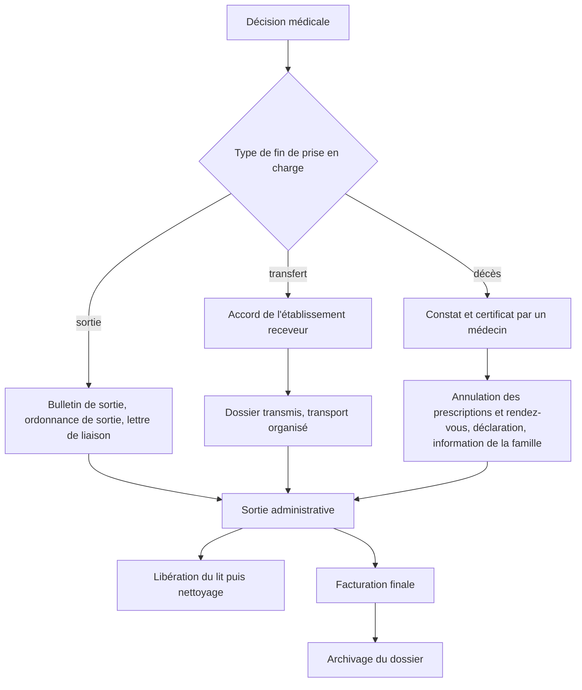

### 9.11 Urgences vitales et codes d'alerte

**Acteurs** : tout soignant, équipe d'intervention, sécurité, direction. **Règles** : les codes (code bleu, code rouge, etc.) sont des données paramétrables : libellé, signification, destinataires, équipe d'intervention, procédure associée. Le déclenchement doit être possible en un geste depuis n'importe quel poste, émet `alert.critical` et diffuse par plusieurs canaux en parallèle (notification applicative, SMS, appel de l'équipe). Toute la chronologie est horodatée.

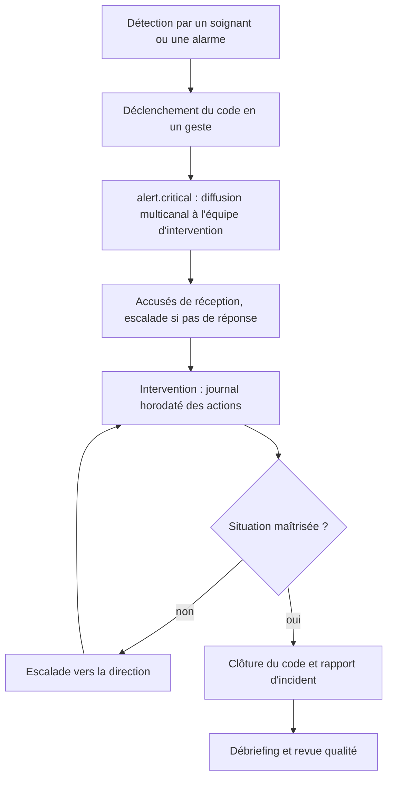

## 10. Sécurité et conformité

Trois principes guident la conception : **moindre privilège** (rien n'est accessible sans permission explicite), **défense en profondeur** (chaque couche contrôle, sans se fier à la précédente) et **sécurité par défaut** (un nouveau paramètre ou module démarre dans son état le plus restrictif).

### 10.1 Exigences et mise en œuvre

| Exigence | Mise en œuvre | Vérification |
| --- | --- | --- |
| RBAC + ABAC | Permissions `MODULE_ACTION`, attributs service / relation de soin / garde (§4) | Tests d'autorisation automatisés sur chaque route |
| Audit des accès médicaux | `auditLog` sur toute lecture et écriture de données de santé : qui, quoi, quel patient, depuis où, pourquoi ; table append-only avec chaîne de hachage | Rapport d'anomalies, revue trimestrielle par l'auditeur |
| Chiffrement en transit | TLS 1.3 de bout en bout ; HSTS ; mTLS entre pods si le maillage de services est activé | Scan TLS en CI et en prod |
| Chiffrement au repos | Volumes chiffrés (AES-256), SSE-KMS sur S3, sauvegardes chiffrées | Contrôle de configuration automatisé |
| Chiffrement des colonnes sensibles | Chiffrement d'enveloppe AES-256-GCM, index aveugles pour la recherche (§8.3) | Test de lecture direct en base : le texte clair ne doit pas apparaître |
| Mots de passe | Argon2id, politique paramétrable (§5.4), refus des mots de passe compromis | Tests unitaires et revue |
| MFA | TOTP et WebAuthn (clé matérielle) ; SMS en secours seulement ; obligatoire pour les rôles sensibles (§4.1) | Rapport de taux d'activation |
| Sessions | Jeton d'accès court (15 min), refresh token à rotation avec détection de réutilisation et révocation, cookie `HttpOnly` `Secure` `SameSite` ; verrouillage et délai d'inactivité paramétrables | Tests E2E de déconnexion et de révocation |
| En-têtes et navigateur | Helmet, CSP stricte sans `unsafe-inline`, CORS en liste blanche, protection CSRF | ZAP et tests d'en-têtes |
| Secrets | Coffre (Vault, Doppler ou gestionnaire du cloud), injection au démarrage, rotation planifiée, aucun secret dans l'image ni dans Git | `gitleaks` en CI |
| Chaîne d'approvisionnement | Dépendances figées, SBOM, scan des images et des paquets | `npm audit`, Snyk, Trivy en CI |
| Sauvegardes | Chiffrées, quotidiennes plus incrémentales, restauration testée (§12) | Journal des tests de restauration |

### 10.2 Risques web couverts

Les catégories du Top 10 OWASP sont traitées par des contrôles concrets, testés en CI.

| Risque | Parade |
| --- | --- |
| Contrôle d'accès défaillant | Autorisation côté serveur sur chaque route, test automatique de déni par défaut, contrôle de propriété de l'objet (pas d'accès direct par identifiant sans vérification) |
| Défaillances cryptographiques | Algorithmes standards uniquement, clés dans le KMS, pas de cryptographie maison |
| Injection | Requêtes paramétrées via Prisma, validation Zod de toute entrée, échappement par défaut de React |
| Conception non sécurisée | Modélisation des menaces par module critique avant développement |
| Mauvaise configuration | Infrastructure décrite en code, configuration durcie, aucun compte par défaut |
| Composants vulnérables | Scan continu et mises à jour de sécurité planifiées |
| Authentification défaillante | MFA, limitation des tentatives, verrouillage, rotation des jetons |
| Intégrité des données et du logiciel | Images signées, pipeline protégé, hachage des documents, webhooks signés |
| Journalisation et supervision insuffisantes | Audit complet, alertes sur anomalies, centralisation des logs |
| Falsification de requête côté serveur (SSRF) | Liste blanche des hôtes sortants pour les intégrations, résolution DNS contrôlée, réseau sortant restreint |

### 10.3 Consentement et droits des personnes

- **Consentement** : enregistré par finalité (soins, partage avec un autre établissement, recherche), horodaté, révocable, et contrôlé avant tout partage externe.
- **Droit d'accès et portabilité** : export du dossier du patient en format structuré (JSON et FHIR) depuis le portail ou sur demande traitée par l'archiviste.
- **Rectification** : par nouvelle version, l'ancienne restant conservée quand la loi l'exige.
- **Effacement** : limité par l'obligation de conservation du dossier médical ; après la durée légale, anonymisation irréversible. Le patient est informé de cette limite.
- **Gouvernance** : registre des traitements, analyse d'impact (AIPD) avant mise en production, désignation d'un délégué à la protection des données.

### 10.4 Conformité

Le socle est le RGPD (données de santé = catégorie particulière), complété par des contrôles de type HIPAA (accès minimum nécessaire, journalisation, chiffrement) et par la législation locale sur les données de santé, qui reste à identifier. **Point bloquant avant production** : validation par un juriste du pays d'exploitation, notamment sur l'hébergement de données de santé (certification ou agrément éventuel de l'hébergeur), les durées de conservation et les déclarations obligatoires. Je ne suis pas juriste : ce dossier prépare les mécanismes, il ne remplace pas cet avis.

### 10.5 Tests de sécurité

Analyse statique (CodeQL), scan des dépendances et des images à chaque pull request, scan dynamique OWASP ZAP sur staging, **test d'intrusion par un tiers avant la mise en production puis chaque année**, revue de configuration cloud, et exercice de réponse à incident deux fois par an.

### 10.6 Plan de réponse aux incidents

1. **Détection** : alertes d'audit, de supervision, signalement d'un utilisateur.
2. **Qualification** : gravité sur une échelle à quatre niveaux ; atteinte aux données de santé = gravité maximale d'office.
3. **Confinement** : révocation des sessions et clés, isolement du composant, bascule en mode dégradé papier si nécessaire.
4. **Éradication et restauration** : correction, restauration depuis une sauvegarde saine, vérification d'intégrité.
5. **Notification** : autorité de contrôle dans les 72 heures en cas de violation de données personnelles (RGPD), information des patients concernés si le risque est élevé, direction et assureur.
6. **Retour d'expérience** : analyse sans reproche, actions correctives suivies.

Rôles : responsable sécurité (pilote), DSI, délégué à la protection des données, direction médicale, communication. Les coordonnées de chaque rôle figurent dans le runbook d'incident (§12.7).

## 11. Interopérabilité

La V1 est **FHIR-ready** : le modèle interne est conçu pour s'exposer en FHIR R4 sans refonte, mais l'exposition FHIR active et HL7 v2 sont livrées en V2 (§14). Toute intégration externe passe par une couche d'adaptateurs isolée (`integration/`), pour qu'un partenaire capricieux ne contamine pas le cœur métier.

### 11.1 Correspondance modèle interne et FHIR R4

| Entité interne | Ressource FHIR R4 |
| --- | --- |
| `patient` | Patient |
| `personnel` | Practitioner, PractitionerRole |
| `etablissement`, `service`, `unite`, `lit` | Organization, Location |
| `admission`, `hospitalisation`, `consultation` | Encounter (+ Composition pour le compte-rendu) |
| `rendez_vous`, agenda | Appointment, Schedule, Slot |
| `allergie`, `antecedent` | AllergyIntolerance, Condition |
| `prescription` médicament | MedicationRequest |
| `dispensation`, `administration` | MedicationDispense, MedicationAdministration |
| Demande d'analyse ou d'imagerie | ServiceRequest |
| `resultat` | Observation, DiagnosticReport |
| Examen d'imagerie | ImagingStudy, DiagnosticReport |
| `prise_en_charge`, `assurance` | Coverage, Organization (payeur) |
| `facture`, `ligne_facture` | Invoice, Claim, ClaimResponse |
| `document` | DocumentReference |
| Consentement | Consent |
| `audit_log` | AuditEvent |

### 11.2 Protocoles et standards

| Domaine | Standard | Approche |
| --- | --- | --- |
| Admissions, transferts, sorties avec systèmes existants | HL7 v2 (messages ADT) | Passerelle d'intégration (par exemple Mirth Connect ou équivalent) qui traduit vers les événements internes |
| Commandes et résultats de laboratoire | HL7 v2 (ORM, OML, ORU) ou FHIR | Même passerelle ; pilote avec un automate et un laboratoire externe cibles |
| Imagerie | DICOM, DICOMweb, liste de travail DICOM (MWL) | Le module `imagerie` alimente la liste de travail des modalités ; un PACS dédié (par exemple Orthanc) stocke les études ; un visualiseur web en lecture. Aucune image dans PostgreSQL |
| Terminologies | CIM-10/11, ATC, LOINC pour la biologie, nomenclature d'actes locale | Chargées comme référentiels versionnés (§5.3) avec tables de correspondance entre versions |
| Échanges de documents entre établissements | FHIR (DocumentReference) ou profil IHE selon le pays | Selon le portail national de santé de l'hôpital, à préciser |
| Authentification des partenaires et SSO | OAuth2, OpenID Connect | Fournisseur d'identité de l'hôpital pour le personnel ; flux `client_credentials` pour les systèmes |

### 11.3 API publique et webhooks

- **API versionnée** `/api/v1`, décrite en OpenAPI 3.1 généré depuis les DTO ; une rupture crée une nouvelle version, l'ancienne restant supportée pendant une durée annoncée.
- **Accès partenaires** : clé ou client OAuth2 par partenaire, **scopes limités** au strict besoin, quota (`integration.api.rate_limit_per_min`), environnement bac à sable avec données fictives.
- **Webhooks signés** : signature HMAC-SHA256 sur le corps et l'horodatage (protection contre le rejeu), relances avec attente croissante, file de rebut, journal des livraisons et rejeu manuel depuis la console, rotation du secret sans coupure.
- **Événements exposés** : sous-ensemble des événements internes (§3.3) choisi par abonnement, sans donnée médicale dans la charge utile par défaut : un identifiant et un type, le partenaire rappelle l'API s'il y est autorisé.

### 11.4 Échanges avec les tiers

| Tiers | Flux | Module | Remarque |
| --- | --- | --- | --- |
| Laboratoires externes | Envoi des demandes, retour des résultats | laboratoire | Résultats rattachés à la prescription d'origine, validés par un biologiste de l'hôpital |
| Mutuelles, assurances, tiers payants | Droits, accord de prise en charge, factures, remboursements | facturation | Un adaptateur par assureur ; formats très hétérogènes, à recenser avant le développement |
| Autres établissements | Transfert de dossier, lettre de liaison | hospitalisation, archivage | Consentement vérifié avant envoi |
| Portail national de santé | Déclarations, partage de documents | administration | Dépend du pays ; à cadrer en phase de préparation |
| Paiement en ligne et mobile | Encaissement | portail-patient, facturation | Passerelle certifiée ; aucune donnée de carte stockée par l'application |
| SMS, email, notifications push | Envoi | notifications | Fournisseurs interchangeables par paramétrage |

## 12. Infrastructure, déploiement et exploitation

**Modèle de déploiement** : une instance dédiée par établissement (ou groupe d'établissements), décrite par un seul chart Helm paramétré par un fichier de valeurs. Ce choix évite le multi-tenant partagé, plus économe mais dont une faille d'isolation exposerait les données de plusieurs hôpitaux ; il rend aussi possible l'hébergement dans le pays de l'hôpital.

### 12.1 Environnements

| Environnement | Infrastructure | Données | Déploiement | Accès |
| --- | --- | --- | --- | --- |
| Local | Docker Compose sur le poste | Seeds de démonstration | Manuel | Développeur |
| Dev | Cluster partagé de petite taille | Données fictives | Automatique à chaque fusion sur la branche principale | Équipe de développement |
| Staging | Miroir de production (même chart, taille réduite) | Données fictives, ou données de production **anonymisées** | Automatique sur étiquette de version | Équipe, recette métier |
| Production | Cluster Kubernetes, PostgreSQL managé ou auto-hébergé avec réplicas | Réelles | **Manuel avec approbation** | Exploitation, accès tracé et limité |

Aucune donnée réelle de patient ne sort de la production vers un autre environnement sans anonymisation.

### 12.2 Conteneurisation

- **Dockerfile multi-stage** pour le backend (construction puis image d'exécution minimale, utilisateur non-root, système de fichiers en lecture seule) et pour le frontend (build statique servi par Nginx ou par CDN).
- **docker-compose** (local, dev, petits sites) : `api`, `worker`, `frontend`, `postgres`, `redis`, `minio`, plus un serveur de messagerie de test ; un PACS de test en option.
- **Kubernetes** (production) : un Deployment pour l'API et un pour les workers, `HorizontalPodAutoscaler`, `PodDisruptionBudget`, `NetworkPolicy` (l'API seule joint la base), Ingress avec certificats automatiques, secrets injectés depuis le coffre.
- **Sondes** : `/health/live` (le processus répond), `/health/ready` (base, Redis et files joignables), sonde de démarrage pour les migrations. Un pod non prêt ne reçoit pas de trafic.

### 12.3 Pipeline CI/CD

Le pipeline suit exactement l'enchaînement imposé ; **la CI bloque** si un test est rouge ou si la couverture est inférieure à 70 % (backend) ou 60 % (frontend).

```mermaid
flowchart LR
  A[Lint] --> B[Typecheck] --> C[Tests unitaires] --> D[Tests d'intégration] --> E[Build] --> F[Scan sécurité] --> G[Tests E2E] --> H[Déploiement staging] --> I[Smoke tests] --> J{{Approbation manuelle}} --> K[Déploiement production] --> L[Smoke tests prod]
  L -- échec --> R[Rollback automatique]
```

Esquisse GitHub Actions (structure des jobs, à compléter lors de l'implémentation) :

```yaml
name: ci-cd
on:
  pull_request:
  push:
    branches: [main]
    tags: ['v*']
jobs:
  lint:        { runs-on: ubuntu-latest }            # eslint, prettier
  typecheck:   { needs: lint }                       # tsc --noEmit (front et back)
  unit:        { needs: typecheck }                  # jest, vitest, seuil de couverture
  integration: { needs: unit }                       # supertest + postgres + redis en services
  build:       { needs: integration }                # images Docker, SBOM, signature
  security:    { needs: build }                      # codeql, trivy, npm audit, snyk, gitleaks
  e2e:         { needs: security }                   # playwright sur environnement éphémère
  deploy-staging:
    needs: e2e
    if: startsWith(github.ref, 'refs/tags/v')
    environment: staging
  smoke-staging: { needs: deploy-staging }           # parcours critiques courts
  deploy-prod:
    needs: smoke-staging
    environment: production                          # réviseurs requis : approbation manuelle
  smoke-prod:
    needs: deploy-prod                               # échec = helm rollback
```

**Garde-fous** : images signées et vérifiées au déploiement, migrations Prisma exécutées par un job dédié avant la bascule du trafic, secrets du pipeline limités par environnement, historique de déploiement conservé.

### 12.4 Observabilité

| Besoin | Outil | Contenu |
| --- | --- | --- |
| Logs | `pino` JSON, collectés vers Loki | Identifiant de corrélation, jamais de donnée de santé en clair |
| Métriques | Prometheus et Grafana | Taux, erreurs et durée par route ; profondeur des files BullMQ ; connexions base ; indicateurs métier (admissions par heure, dispensations, factures émises) |
| Traces | OpenTelemetry vers Tempo ou Jaeger | Parcours d'une requête de l'ingress à la base et aux workers |
| Erreurs applicatives | Sentry | Masquage des données personnelles avant envoi |
| Disponibilité vue de l'extérieur | Uptime Kuma ou Better Stack | Sondes synthétiques sur connexion, recherche patient, admission |
| Alertes | Alertmanager vers PagerDuty, Opsgenie ou Slack | Astreinte, escalade, accusé de réception |

Alertes de base : taux d'erreurs 5xx, latence au 95e centile, file bloquée, échec de sauvegarde, espace disque, échec d'écriture d'audit, certificat proche de l'expiration. Les seuils sont à calibrer après les tests de charge. Objectif de disponibilité proposé : **99,9 %** (environ 8 h 45 d'indisponibilité par an), à valider avec la direction.

### 12.5 Sauvegardes, PRA et PCA

Objectifs imposés : **RTO inférieur à 4 heures** (durée maximale d'interruption) et **RPO inférieur à 1 heure** (perte de données maximale). Ils ne sont tenus que s'ils sont mesurés : chaque test de restauration enregistre le RTO et le RPO réellement obtenus.

| Donnée | Stratégie | Protection |
| --- | --- | --- |
| PostgreSQL | Sauvegarde complète quotidienne plus archivage continu des journaux de transactions (WAL), pour restaurer à la minute précise (PITR) | Chiffrée, copie dans un second site, écriture non modifiable (verrouillage d'objet) contre le ransomware |
| Fichiers S3 (documents, imagerie) | Versionnement des objets et réplication vers un autre site | Même protection |
| Redis | Reconstructible (cache, files) ; persistance AOF pour limiter la perte de tâches en attente | Les tâches critiques sont de toute façon reprises depuis la table `outbox` |
| Configuration et secrets | Infrastructure et chart Helm dans Git ; coffre sauvegardé séparément | Accès restreint, deux personnes |
| Journaux d'audit | Archivage vers un stockage non modifiable pour la durée de rétention | Chaîne de hachage vérifiée |

**Scénarios du plan de reprise (PRA)**

| Scénario | Réponse |
| --- | --- |
| Panne d'un pod ou d'un nœud | Automatique : replanification Kubernetes, aucune action humaine |
| Panne de la base primaire | Bascule vers un réplica promu ; contrôle d'intégrité ; rétablissement d'un nouveau réplica |
| Panne d'une zone ou d'un site | Reconstruction sur le second site depuis le code d'infrastructure et la dernière sauvegarde ; mise à jour du DNS |
| Corruption logique ou erreur humaine | Restauration PITR dans un environnement isolé, puis réinjection des données saines |
| Ransomware ou intrusion | Isolement, restauration depuis une sauvegarde non modifiable, rotation de tous les secrets, procédure §10.6 |
| Perte du fournisseur d'hébergement | Restauration chez un second fournisseur depuis la copie hors site |

**Plan de continuité (PCA) : mode dégradé pendant la panne.** Un extrait en lecture seule des informations vitales (patients hospitalisés, allergies, prescriptions en cours, plannings) est synchronisé régulièrement vers un support accessible hors du système principal (poste local chiffré et impression sécurisée par unité). Des formulaires papier prénumérotés permettent de continuer les soins ; la saisie rétroactive est faite après la reprise, avec rapprochement par un responsable.

**Tests** : restauration automatisée **mensuelle** dans un environnement isolé avec vérifications d'intégrité ; exercice complet de PRA au moins **une fois par an** ; résultats archivés et présentés à la direction.

### 12.6 Exploitation courante

| Sujet | Approche |
| --- | --- |
| Mises à jour sans coupure | Rolling update derrière les sondes de disponibilité ; migrations « expand puis contract » en deux déploiements (ajout rétro-compatible, puis nettoyage) |
| Migrations de base | Prisma Migrate dans un job dédié en CI/CD, avec revue et sauvegarde préalable ; jamais de migration destructive en même temps que le code qui en dépend |
| Feature flags | Unleash, ou un flag stocké comme paramètre (§5) ; permet d'activer un module par établissement et de couper une fonction fautive sans redéployer |
| Rollback | Automatique à l'échec des smoke tests de production (retour à la version précédente de l'image) ; impossible de revenir en arrière sur une migration non rétro-compatible, d'où la règle ci-dessus |
| Versions | SemVer, journal des changements, notes de version par rôle |
| Fenêtre de maintenance | En dehors des heures de pointe, annoncée par notification dans l'application |
| Correctifs de sécurité | Délai de déploiement fixé selon la gravité (critique : sous 72 heures, à valider) |

### 12.7 Runbooks d'exploitation

Chaque runbook tient sur une page : déclencheur, vérifications, actions, critères de succès, escalade. Ils sont versionnés avec le code et testés lors des exercices.

| Runbook | Déclencheur | Étapes clés |
| --- | --- | --- |
| Déploiement en production | Version approuvée | Vérifier la sauvegarde récente → lancer la migration → déploiement progressif → smoke tests → surveillance 30 minutes |
| Rollback | Échec des smoke tests ou alerte post-déploiement | Retour à l'image précédente → vérifier la compatibilité de schéma → informer les utilisateurs |
| API en erreur ou lente | Alerte 5xx ou latence | Consulter les traces et logs par identifiant de corrélation → identifier le module → couper un flag ou ajouter des réplicas |
| Base saturée ou lente | Alerte connexions ou requêtes lentes | Identifier les requêtes → vérifier PgBouncer → décharger sur un réplica de lecture |
| File BullMQ bloquée | Profondeur de file en hausse | Inspecter la file de rebut → corriger la cause → rejouer les tâches idempotentes |
| Échec de sauvegarde | Alerte de sauvegarde | Relancer → vérifier l'espace et les droits → si deux échecs, escalade et sauvegarde manuelle |
| Restauration PITR | Corruption ou suppression erronée | Fixer l'instant cible → restaurer en environnement isolé → contrôler → réinjecter ou basculer |
| Rotation de secrets | Calendrier ou suspicion de fuite | Créer le nouveau secret → déployer → révoquer l'ancien → vérifier les intégrations |
| Incident de sécurité | Alerte d'audit ou signalement | Procédure §10.6 |
| Panne d'un fournisseur SMS ou email | Taux d'échec de remise | Basculer sur le fournisseur de secours par paramètre → rejouer les envois en échec |
| Mise en service d'un nouvel établissement | Contrat signé | Déployer le chart avec ses valeurs → seeds de référence → import du paramétrage → formation → recette (§15) |

## 13. Qualité et plan de tests

La stratégie suit une pyramide : beaucoup de tests rapides sur la logique métier (où sont les règles cliniques et financières), moins de tests d'intégration, peu de tests E2E mais sur les parcours critiques. Le plan de test est **généré en partie depuis les données** : la matrice RBAC (§4) produit les tests d'autorisation, les workflows (§9) produisent les tests de transition.

### 13.1 Niveaux de test

| Niveau | Outil | Périmètre | Seuil bloquant en CI |
| --- | --- | --- | --- |
| Unitaire backend | Jest | Services (règles métier), calculs de tarification, validateurs | Couverture ≥ 70 % ; ≥ 90 % sur facturation, pharmacie et laboratoire (modules à risque) |
| Unitaire frontend | Vitest + Testing Library | Composants, hooks, schémas Zod | Couverture ≥ 60 % |
| Intégration | Supertest + PostgreSQL et Redis réels en conteneurs | Routes complètes : middlewares, transaction, outbox, audit | Aucun test rouge |
| Contrat d'événements | Jest | Le schéma de chaque événement émis correspond à ce que ses consommateurs attendent | Aucun test rouge |
| Autorisation | Jest, généré depuis la matrice RBAC | Chaque rôle × chaque route : accès autorisé ou refus attendu ; séparation des tâches | 100 % des routes couvertes |
| Paramétrage et workflows | Jest | Une modification de paramètre ou de workflow change bien le comportement, sans redéploiement ; retour arrière | Aucun test rouge |
| E2E | Playwright | Parcours critiques (voir 13.2) sur environnement éphémère | Aucun test rouge |
| Charge | k6 | Admission, dispensation, facturation (voir 13.3) | Seuils définis ci-dessous, en pré-production |
| Sécurité | CodeQL, ZAP, `npm audit`, Snyk, Trivy | Dépendances, images, application en cours d'exécution | Aucune vulnérabilité critique non traitée |
| Accessibilité | `axe-core` dans Playwright | Écrans principaux | Aucune violation de niveau AA |
| Régression visuelle (optionnel) | Playwright, comparaison d'images | Composants du design system | Revue manuelle des écarts |

### 13.2 Parcours E2E critiques

1. Connexion avec MFA, verrouillage après échecs, expiration de session.
2. Création d'un patient, détection de doublon, fusion.
3. Admission aux urgences, triage, orientation vers l'hospitalisation, affectation d'un lit.
4. Prescription, validation pharmaceutique, dispensation, administration, avec refus lorsqu'une même personne tente deux étapes.
5. Prescription d'analyse, prélèvement, saisie, validation biologique, résultat visible chez le médecin et sur le portail.
6. Facturation avec prise en charge partielle, encaissement, avoir.
7. Modification d'un tarif et d'un workflow dans le paramétrage, effet immédiat, retour arrière.
8. Sortie, facturation finale, archivage.
9. Mode hors-ligne : saisie de constantes puis synchronisation.
10. Droit d'accès : export du dossier par le patient.

### 13.3 Tests de charge

| Scénario | Profil | Seuil proposé |
| --- | --- | --- |
| Admission | Montée par paliers à 10, 100, 500 puis 1 000 utilisateurs simultanés ; mélange recherche patient, création, admission | 95e centile de latence inférieur à 800 ms en lecture et 1,5 s en écriture ; erreurs inférieures à 1 % |
| Dispensation | Pic de dispensations concurrentes sur un même lot | Aucune sur-délivrance, aucun stock négatif, latence comme ci-dessus |
| Facturation | Clôture de journée avec forte volumétrie ; numérotation sans trou sous concurrence | Aucune facture dupliquée ni numéro manquant |
| Endurance | Charge moyenne pendant plusieurs heures | Pas de fuite de mémoire, files vidées |
| Panne | Arrêt d'un pod et d'un réplica en pleine charge | Reprise sans perte de donnée |

Les seuils sont des propositions à confirmer avec les utilisateurs ; les valeurs mesurées servent ensuite à dimensionner les paliers de §2.6.

### 13.4 Données de test et critères de sortie

- **Données** : jeux fictifs générés (patients, structure, tarifs) ; aucune donnée réelle ; staging alimenté par des données de production **anonymisées** seulement.
- **Critères pour livrer** : tests verts, couverture atteinte, aucune vulnérabilité critique, parcours E2E rejoués sur staging, recette métier signée par un utilisateur de chaque service concerné (§15).
- **Gestion des défauts** : gravité bloquante (risque patient ou perte de données), majeure, mineure ; un défaut bloquant arrête la mise en production.

## 14. Roadmap et user stories

La livraison est organisée en trois versions, séparées par des **portes de qualité** : on ne démarre pas la version suivante, ni la mise en service, tant que la porte n'est pas franchie. Les durées ne sont pas chiffrées ici : elles dépendent de la taille de l'équipe et du cadrage de la phase 0.

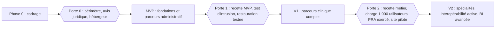

### 14.1 Contenu de chaque version

| Version | Objectif | Contenu |
| --- | --- | --- |
| Phase 0 | Réduire les incertitudes avant de construire | Pays et réglementation, hébergeur, interviews par service, glossaire, tarifs et référentiels de départ, modèle de menaces, maquettes des écrans principaux |
| MVP | Un hôpital peut enregistrer, consulter, facturer et auditer | Fondations (auth, paramétrage, audit, notifications, administration) + patients, admission, rendez-vous et consultations, facturation et caisse. CI/CD, observabilité et sauvegardes dès cette version |
| V1 | Parcours clinique de bout en bout | Urgences, hospitalisation, soins infirmiers, pharmacie, laboratoire, imagerie, bloc, maternité, stocks, personnel, archivage, reporting, portail patient |
| V1.x | Services support et spécialisés | Réanimation, banque du sang, stérilisation, maintenance, restauration, hygiène |
| V2 | Ouverture et décisionnel | Téléconsultation, FHIR et HL7 actifs, BI avancée, intégrations avec assureurs et portail national |

### 14.2 Priorisation MoSCoW par module

**M** = indispensable · **S** = important · **C** = souhaitable · **W** = reporté volontairement. La colonne indique la version où le module est livré et sa priorité à ce moment-là.

| Module | Version | Priorité | Justification |
| --- | --- | --- | --- |
| auth, parametrage, audit | MVP | M | Fondations dont tout dépend |
| notifications | MVP | M | Rappels et alertes requis dès le début ; canaux limités à email et SMS |
| administration | MVP | M | Sauvegardes, santé des services, intégrations |
| patients | MVP | M | Dossier unique et MPI |
| admission | MVP | M | Entrée dans le parcours |
| consultation | MVP | M | Premier parcours clinique ambulatoire |
| facturation | MVP | M | Viabilité économique de l'hôpital |
| reporting | MVP puis V1 | S | Tableaux de bord de base au MVP, complets en V1 |
| urgences | V1 | M | Parcours vital |
| hospitalisation | V1 | M | Lits et mouvements |
| soins-infirmiers | V1 | M | Administration et plan de soins |
| pharmacie | V1 | M | Circuit du médicament, risque élevé |
| laboratoire | V1 | M | Circuit des analyses |
| imagerie | V1 | M | Examens et comptes-rendus ; PACS externe intégré |
| bloc, maternite | V1 | S | Activités spécialisées fréquentes |
| stock | V1 | M | Approvisionnement, dépendance de la pharmacie |
| personnel | V1 | S | Gardes et plannings ; la paie peut rester dans l'outil existant |
| archivage | V1 | S | Obligation de conservation |
| portail-patient | V1 | S | Valeur forte, mais après la stabilisation du cœur |
| reanimation, banque-sang | V1.x | S | Spécialisés, forte exigence de sûreté |
| sterilisation, maintenance | V1.x | C | Support |
| restauration, hygiene | V1.x | C | Support |
| teleconsultation | V2 | C | Optionnel d'après le cahier des charges |
| Paie complète | V2 ou jamais | W | Souvent déjà couverte par un autre outil ; à confirmer |

### 14.3 User stories par module (INVEST)

Chaque histoire est **indépendante** (livrable seule), **négociable**, **de valeur** pour un acteur, **estimable**, **petite** (quelques jours) et **testable** grâce à ses critères d'acceptation. Ce sont les histoires directrices de chaque module ; le découpage fin se fait en backlog après la phase 0. Les critères se lisent « étant donné / quand / alors » en forme abrégée et deviennent des tests automatisés.

| ID | Histoire | Critères d'acceptation |
| --- | --- | --- |
| AUTH-01 | En tant qu'utilisateur d'un rôle sensible, je veux me connecter avec un second facteur afin de protéger les données de santé | Mot de passe valide mais pas de code MFA : aucune session. Après le nombre d'échecs paramétré, le compte est verrouillé pour la durée paramétrée. Chaque tentative est journalisée |
| AUTH-02 | En tant qu'administrateur, je veux attribuer un rôle sensible avec double approbation | L'attribution reste en attente jusqu'à l'accord d'un second administrateur ; les deux sont tracés ; on ne peut pas s'approuver soi-même |
| PARAM-01 | En tant que responsable financier, je veux modifier un tarif sans redéploiement | La nouvelle version prend effet à la date choisie ; l'ancienne reste consultable ; retour arrière possible ; le journal indique auteur, ancienne et nouvelle valeur, motif |
| PARAM-02 | En tant que DSI, je veux définir les statuts et transitions d'un workflow | Une transition non déclarée est refusée par l'API ; le workflow peut être testé en prévisualisation avant publication |
| PAT-01 | En tant que réceptionniste, je veux créer un patient et être alerté d'un doublon probable | Au-dessus du seuil de similarité, la création propose les dossiers proches ; aucune fusion automatique ; choix tracé |
| PAT-02 | En tant qu'administrateur des patients, je veux fusionner deux dossiers de façon réversible | Historique des deux dossiers conservé ; annulation possible ; fusion soumise à approbation si le paramètre l'exige |
| ADM-01 | En tant que réceptionniste, je veux admettre un patient et vérifier ses droits | La catégorie et la prise en charge sont enregistrées ; une admission déjà ouverte est signalée ; `patient.admitted` est émis |
| CONS-01 | En tant qu'agent d'accueil, je veux prendre un rendez-vous sur un créneau libre | Deux réservations simultanées du même créneau : une seule réussit ; rappels envoyés aux délais paramétrés |
| CONS-02 | En tant que médecin, je veux rédiger et signer un compte-rendu de consultation | Après signature il est immuable ; une correction crée une version liée avec motif ; l'ancienne reste consultable |
| URG-01 | En tant qu'infirmier d'accueil et d'orientation, je veux trier un patient selon l'échelle paramétrée | Le niveau affiche le délai cible ; son dépassement alerte le chef de service ; un niveau vital permet un enregistrement en identité provisoire |
| HOSP-01 | En tant que gestionnaire de lits, je veux affecter un lit adapté | Un lit ne peut jamais être attribué deux fois, même en concurrence ; un lit « à nettoyer » n'est pas proposé |
| HOSP-02 | En tant que médecin, je veux prononcer la sortie d'un patient | Impossible sans bulletin de sortie si le paramètre l'exige ; le lit passe à « à nettoyer » ; la facturation finale est déclenchée |
| SOINS-01 | En tant qu'infirmier, je veux enregistrer l'administration d'un médicament | Contrôle patient, produit, dose, heure ; refus si non conforme ; double contrôle pour les produits à risque ; lot tracé |
| PHARM-01 | En tant que pharmacien, je veux valider une ordonnance avec alertes | Une interaction ou allergie bloquante empêche la validation sans motif ; un prescripteur ne peut pas valider sa propre prescription |
| PHARM-02 | En tant que préparateur, je veux dispenser par lot | Le lot le plus proche de la péremption est proposé ; le stock ne devient jamais négatif ; le lot est tracé jusqu'au patient |
| LAB-01 | En tant que technicien, je veux saisir un résultat d'analyse | Une valeur hors seuil critique émet `alert.critical` ; le résultat n'est pas visible du patient tant qu'il n'est pas validé |
| LAB-02 | En tant que biologiste, je veux valider un résultat | Le validateur est différent du saisissant ; le résultat devient immuable ; publié au dossier puis au portail selon le délai paramétré |
| IMG-01 | En tant que radiologue, je veux signer un compte-rendu d'imagerie | Diffusion uniquement après signature ; les images sont liées par l'identifiant d'étude DICOM |
| BLOC-01 | En tant que chirurgien, je veux planifier une intervention sans conflit | Salle, équipe et matériel sont exclusifs sur le créneau ; la checklist de sécurité est obligatoire avant clôture |
| MAT-01 | En tant que sage-femme, je veux enregistrer un accouchement et créer le dossier du nouveau-né | Le nouveau-né a son identifiant propre et est lié à sa mère ; `newborn.registered` est émis |
| REA-01 | En tant que réanimateur, je veux voir les constantes avec alarmes | Le franchissement d'un seuil paramétré affiche une alarme et émet `icu.alarm.raised` |
| STER-01 | En tant qu'agent de stérilisation, je veux tracer un cycle | Chaque boîte est liée à un cycle ; une boîte non conforme est bloquée pour le bloc |
| SANG-01 | En tant que biologiste, je veux libérer une poche compatible | Refus si incompatible ; traçabilité du don à la transfusion |
| FACT-01 | En tant que caissier, je veux encaisser une facture | Montant au plus égal au reste dû ; reçu numéroté ; un double clic ne crée pas deux paiements ; clôture de caisse équilibrée |
| FACT-02 | En tant qu'agent de facturation, je veux appliquer une convention d'assurance | Parts assureur et patient calculées selon le taux et le plafond ; une facture émise est immuable ; correction par avoir |
| FACT-03 | En tant que caissier, je veux rembourser un patient dans la limite de mon plafond | Au-dessus du plafond du rôle, l'opération exige un second rôle ; écriture inverse tracée |
| RH-01 | En tant que cadre, je veux générer un planning de garde conforme | Repos minimal, quotas et congés approuvés respectés ; la publication notifie les agents |
| STOCK-01 | En tant que magasinier, je veux être alerté quand un article passe sous son seuil | `stock.low` est émis ; une proposition de commande est calculée ; l'auteur d'une commande ne peut pas la réceptionner |
| MAINT-01 | En tant qu'agent de maintenance, je veux ouvrir et clôturer un ordre de travail | Un équipement en panne est marqué indisponible ; la calibration périodique est planifiée |
| RESTO-01 | En tant que diététicien, je veux que les repas respectent régimes et allergies | Un repas contenant un allergène déclaré est refusé sauf dérogation tracée |
| HYG-01 | En tant qu'agent d'hygiène, je veux valider le nettoyage d'une chambre | La validation libère le lit et est horodatée |
| ARCH-01 | En tant qu'archiviste, je veux archiver et prêter un dossier | La durée de conservation par type est appliquée ; tout prêt est tracé ; la destruction exige une double validation |
| NOTIF-01 | En tant que patient, je veux recevoir un rappel dans ma langue | Le modèle de ma langue est utilisé ; réessais selon le paramètre ; un échec est journalisé |
| REP-01 | En tant que directeur, je veux un tableau de bord d'occupation et de chiffre d'affaires | Données à jour selon la fraîcheur paramétrée ; filtre par service ; export ; aucune donnée nominative |
| AUD-01 | En tant qu'auditeur, je veux savoir qui a consulté un dossier | Filtre par patient, utilisateur et période ; résultats non modifiables ; accès d'urgence signalés |
| ADMIN-01 | En tant que DSI, je veux voir l'état des sauvegardes et des services | Dernière sauvegarde et dernier test de restauration affichés ; alerte en cas d'échec |
| PORT-01 | En tant que patient, je veux consulter mes résultats et exercer mes droits | Un code à usage unique est exigé ; seuls mes résultats publiés sont visibles ; l'export de mon dossier est disponible |
| TELE-01 | En tant que médecin, je veux mener une consultation à distance (V2) | La salle est liée au rendez-vous ; seuls les deux participants y accèdent ; la séance est tracée dans le dossier |
| SEC-01 | En tant que soignant, je veux ouvrir un dossier en urgence vitale sans relation de soin | Motif obligatoire, durée limitée, alerte au responsable et à l'auditeur |
| OFF-01 | En tant qu'infirmier en zone mal connectée, je veux saisir des constantes hors-ligne | File locale chiffrée ; synchronisation avec fusion par horodatage ; aucune perte |

## 15. Couverture des livrables, checklist de validation et questions ouvertes

Le cahier des charges demande 18 livrables et une conception sans code. Onze sont couverts, six le sont partiellement (forme de référence à compléter) et un n'est pas produit. Le tableau est volontairement franc sur ce qui manque.

### 15.1 Couverture des 18 livrables

| # | Livrable | Où | État | Ce qui reste à produire |
| --- | --- | --- | --- | --- |
| 1 | Résumé exécutif | §1 | Couvert |  |
| 2 | Architecture globale (C4) | §2 | Couvert | Niveau code (4) non produit, inutile avant l'implémentation |
| 3 | Découpage modulaire par service | §3 | Couvert |  |
| 4 | Modèle de données (ERD) | §8 | Partiel | ERD détaillé des entités propres à chaque module (stérilisation, maintenance, restauration, maternité, banque du sang…), à faire module par module |
| 5 | Matrice RBAC | §4 | Partiel | La matrice par famille de modules est livrée ; la matrice permission par permission est générée depuis le seed, après validation des familles par les métiers |
| 6 | Liste exhaustive des paramètres | §5 | Partiel | Catalogue de référence (une cinquantaine de paramètres scalaires, dix familles d'entités) ; le catalogue complet se complète module par module |
| 7 | Spécification API (OpenAPI) | §3.2 | Partiel | Endpoints principaux par module ; le fichier OpenAPI complet est généré depuis les DTO à l'implémentation |
| 8 | Structure MVC de chaque module | §6 | Couvert | La structure est identique pour les 29 modules |
| 9 | User stories et critères d'acceptation | §14.3 | Partiel | Histoires directrices (1 à 3 par module) ; le backlog fin est créé après la phase 0 |
| 10 | Workflows transverses | §9 | Couvert |  |
| 11 | Roadmap MVP, V1, V2 (MoSCoW) | §14 | Couvert | Durées à chiffrer après cadrage |
| 12 | Plan de tests | §13 | Couvert |  |
| 13 | Architecture de déploiement et hébergement | §2, §12 | Couvert | Manifests et chart Helm à écrire à l'implémentation |
| 14 | Pipeline CI/CD | §12.3 | Couvert | Esquisse de structure ; le YAML complet est écrit avec le dépôt |
| 15 | Runbooks d'exploitation | §12.7 | Partiel | Liste et étapes clés ; pas à pas détaillé, à rédiger et à tester sur l'infrastructure réelle |
| 16 | Plan de sauvegarde et PRA/PCA | §12.5 | Couvert | Procédures détaillées à écrire avec l'hébergeur retenu |
| 17 | Documentation utilisateur par rôle | — | Non produit | Dépend des écrans définitifs ; un guide par famille de rôles (§4.1) sera rédigé après les maquettes |
| 18 | Checklist de validation | §15.2 à 15.4 | Couvert |  |

### 15.2 Checklist de validation métier

- [ ] Périmètre des 29 modules confirmé, modules hors périmètre listés
- [ ] Organigramme réel (services, unités, lits) saisi dans le paramétrage et validé par les chefs de service
- [ ] Rôles, permissions et séparation des tâches validés par chaque responsable de service
- [ ] Tarifs, conventions et taux de prise en charge fournis, puis testés sur des dossiers réels passés
- [ ] Référentiels (CIM, ATC, actes, médicaments, analyses) chargés dans la bonne version
- [ ] Modèles de documents (ordonnance, compte-rendu, certificat, bulletin de sortie) validés par la direction médicale
- [ ] Protocoles, interactions bloquantes et valeurs critiques validés par le pharmacien-chef et le biologiste-chef
- [ ] Workflows d'admission, de sortie, de transfert et de décès validés par les utilisateurs
- [ ] Recette menée par au moins un utilisateur de chaque service, sur des scénarios réels
- [ ] Formation par rôle réalisée, documentation remise
- [ ] Procédures papier du mode dégradé écrites, imprimées et connues des équipes
- [ ] Reprise des données existantes (patients historiques) validée par une répétition complète
- [ ] Décision de mise en service signée par la direction générale et la direction médicale

### 15.3 Checklist de validation technique

- [ ] Pipeline complet au vert, couverture ≥ 70 % backend et ≥ 60 % frontend
- [ ] CI vérifiant l'absence d'import croisé entre modules et le respect des couches
- [ ] Tests d'autorisation couvrant 100 % des routes
- [ ] Tests de charge à 1 000 utilisateurs simultanés réussis dans les seuils (§13.3)
- [ ] Migrations rejouées sur une copie de la production, retour arrière testé
- [ ] Sauvegardes quotidiennes et archivage WAL actifs ; restauration réussie avec RTO < 4 h et RPO < 1 h **mesurés**
- [ ] Exercice de PRA complet réalisé et documenté
- [ ] Supervision et alertes en place, astreinte nommée et joignable
- [ ] Secrets dans le coffre, rotation testée, aucun secret dans Git
- [ ] TLS 1.3 et renouvellement automatique des certificats vérifiés
- [ ] Journal d'audit en écriture seule et chaîne de hachage contrôlées
- [ ] Chiffrement des colonnes sensibles vérifié par lecture directe de la base
- [ ] Test d'intrusion réalisé, vulnérabilités critiques et hautes corrigées
- [ ] Scan des dépendances et des images sans vulnérabilité critique ouverte
- [ ] Accessibilité WCAG 2.1 AA vérifiée sur les écrans principaux
- [ ] Runbooks rédigés et rejoués lors d'un exercice
- [ ] Aucune donnée de démonstration en production
- [ ] Plan de retour arrière du jour de mise en service prêt

### 15.4 Checklist de conformité

- [ ] Avis juridique local obtenu (hébergement des données de santé, conservation, déclarations)
- [ ] Analyse d'impact (AIPD) réalisée, délégué à la protection des données désigné, registre des traitements à jour
- [ ] Durées de conservation configurées selon l'avis juridique
- [ ] Procédure d'exercice des droits des patients (accès, rectification, portabilité) testée de bout en bout
- [ ] Plan de réponse aux incidents exercé, contacts à jour

### 15.5 Questions ouvertes à trancher avant la phase 0

Ces réponses changent le dimensionnement, le coût ou le périmètre ; je les ai remplacées par des hypothèses signalées dans le document.

1. **Pays et réglementation** : quelles lois sur les données de santé, quels hébergeurs autorisés ?
2. **Taille de l'établissement** : nombre de lits, d'utilisateurs, de sites ; hospitalisation et bloc dès la V1 ou non ?
3. **Connectivité** : fiabilité du réseau, besoin réel du hors-ligne, hébergement local obligatoire ?
4. **Langues et devises** de l'interface, des documents et de la caisse.
5. **Équipements à connecter** : automates de laboratoire, modalités d'imagerie, PACS existant.
6. **Assureurs et mutuelles** : lesquels, quels formats d'échange, quelles conventions.
7. **Systèmes existants** : outils à remplacer, à conserver (paie, comptabilité) ou à migrer.
8. **Équipe et budget** : taille de l'équipe de développement, capacité d'exploitation 24 h sur 24, choix entre Kubernetes et Docker Compose pour un petit site.
